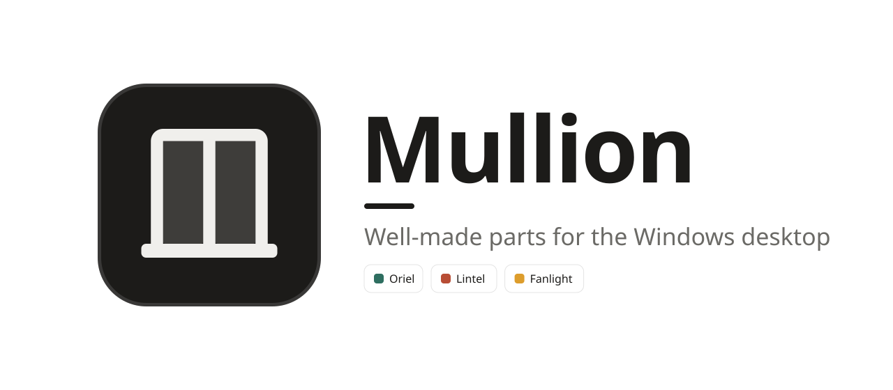
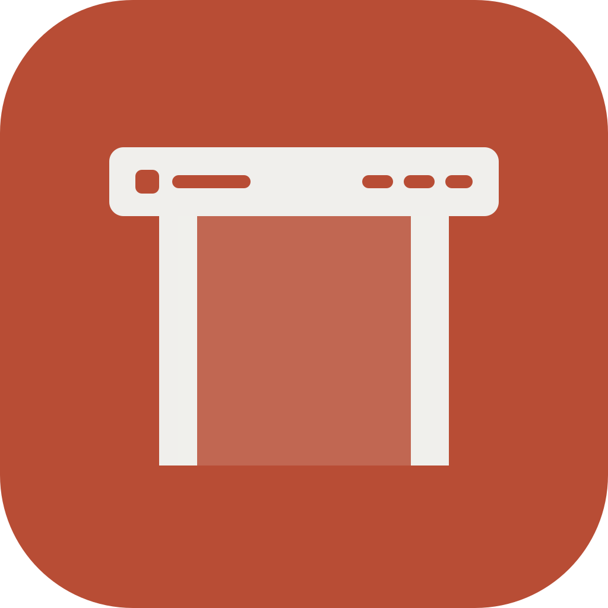
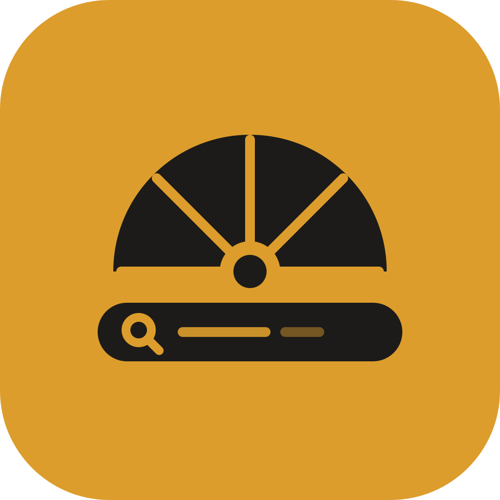
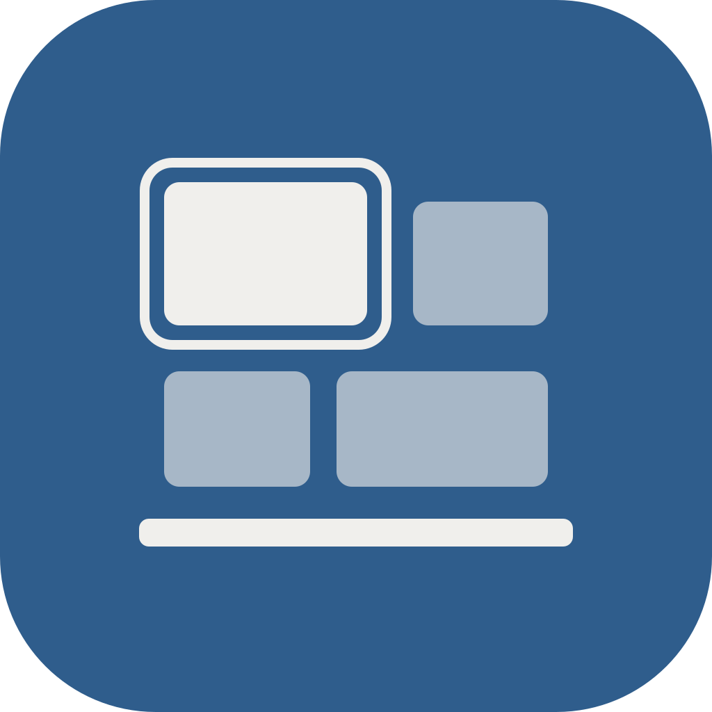
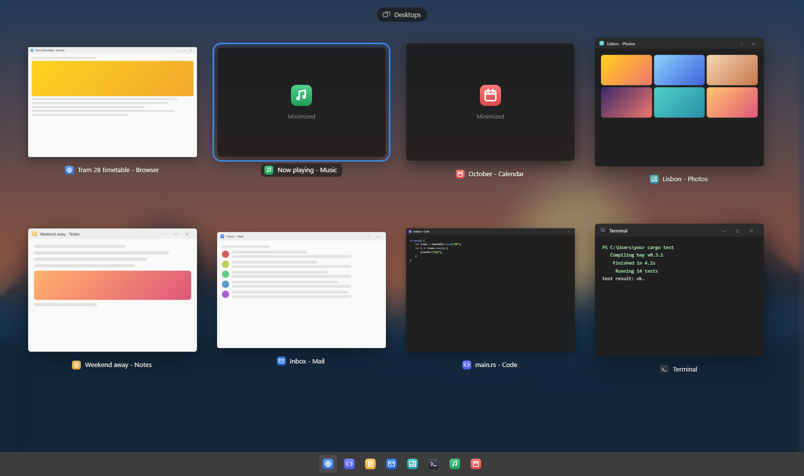
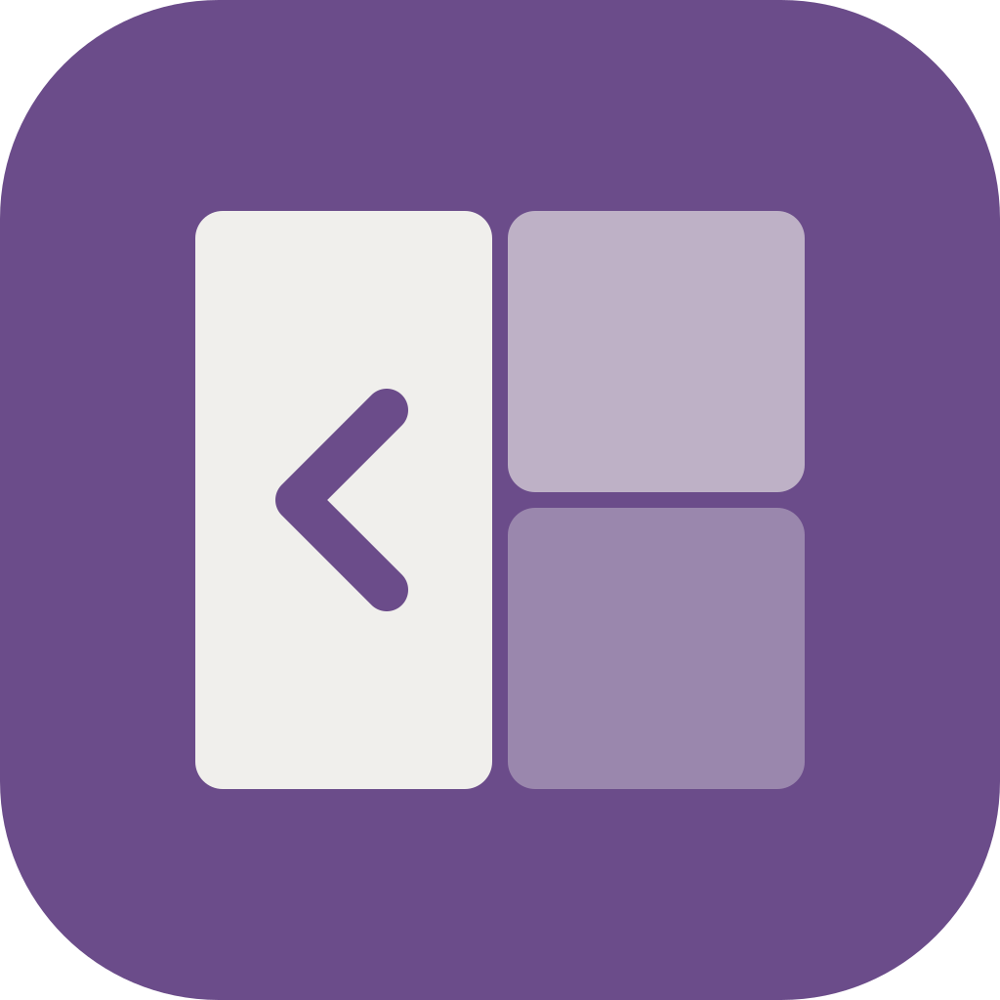
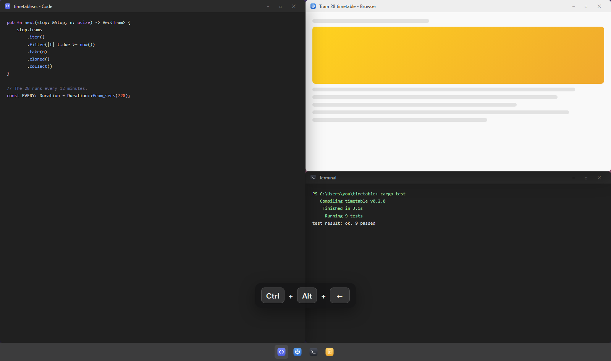
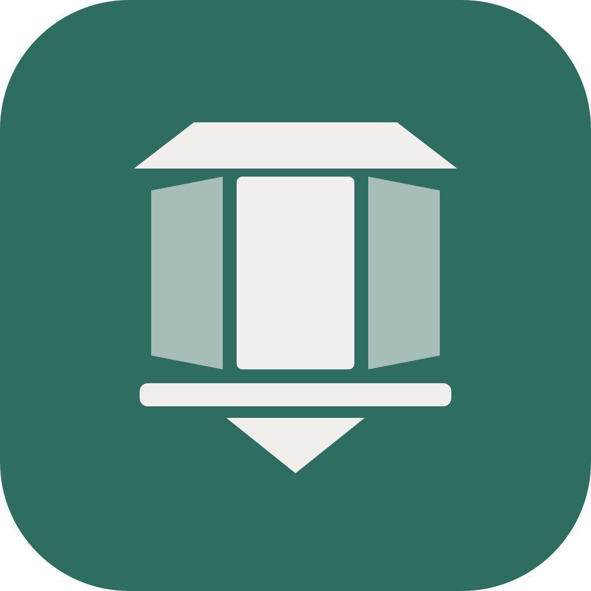
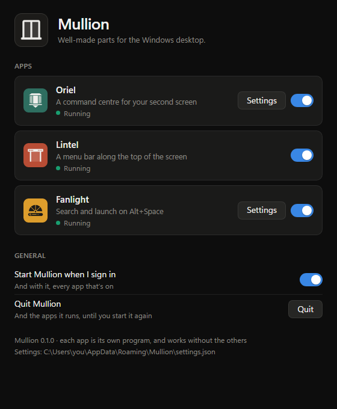

<picture>
  <source media="(prefers-color-scheme: dark)" srcset="apps/mullion/assets/banner-dark.svg">
  
</picture>

**Well-made parts for the Windows desktop.**

[The apps](#the-apps) · [Install](#install) · [One icon for all of them](#one-icon-for-all-of-them) · [Contributing](#contributing)

Mullion is a set of small apps for Windows, each named after a part of a window (a mullion is the
bar between two panes). A menu bar, a search field, a dashboard for your second screen, every
window at once, windows that snap into place: the parts a desktop is missing, made to feel like
they came with it.

- **Take what you want.** Each app is its own program. Install one or all of them, quit any of
  them, and the rest carry on.
- **One desktop.** They share six palettes, each in dark and light, solid or glass, and follow
  Windows' own light or dark if you like. Give each app its own look, or one look to them all.
- **Private.** No accounts and no telemetry. Nothing goes online but Oriel's weather and calendar,
  only once you add them, and Mullion's check for updates, once a day, which you can turn off.
- **Small.** Rust and the WebView2 that Windows already has, so each app's installer is under
  2 MB.

## The apps

###  Lintel

**A menu bar along the top of the screen.** The app you're in, your open apps, what's playing, a
Control Centre and the clock, in one slim bar, the way macOS and Linux desktops have it. Click an
item and its menu grows out of the bar. [More about Lintel](apps/lintel/README.md)

<picture>
  <source media="(prefers-color-scheme: light)" srcset="apps/lintel/docs/images/bar-light.png">
  
</picture>

###  Fanlight

**Search and launch on <kbd>Alt</kbd> + <kbd>Space</kbd>.** Apps, files, settings, open windows,
sums, what you copied and the web, in one field that opens over whatever you're doing. Press
<kbd>Space</kbd> to look at a result before you open it. [More about Fanlight](apps/fanlight/README.md)

<picture>
  <source media="(prefers-color-scheme: light)" srcset="apps/fanlight/docs/images/search-light.png">
  
</picture>

###  Bay

**Every open window at once, on <kbd>Win</kbd> + <kbd>Ctrl</kbd> + <kbd>↑</kbd>.** Your windows
step back into a grid, live, over your blurred wallpaper. Pick one and it comes to the front, or
drag it to another screen. [More about Bay](apps/bay/README.md)

<picture>
  <source media="(prefers-color-scheme: light)" srcset="apps/bay/docs/images/overview-light.png">
  
</picture>

###  Sash

**Windows snapped into place, on <kbd>Ctrl</kbd> + <kbd>Alt</kbd> + arrows.** The window in front
takes half the screen, then two-thirds or a third if you press again, or a quarter, meeting the
next one exactly. Maximize it, centre it, or send it to your other screen, all from the keyboard.
[More about Sash](apps/sash/README.md)

<picture>
  <source media="(prefers-color-scheme: light)" srcset="apps/sash/docs/images/snapped-light.png">
  
</picture>

###  Oriel

**A dashboard for your second screen.** CPU, GPU, memory, network, disks and processes, plus
what's playing, the weather and your calendar, on one calm, full-screen page you can read from
across the desk. Arrange it as you like, over as many pages as you want. [More about Oriel](apps/oriel/README.md)

<picture>
  <source media="(prefers-color-scheme: light)" srcset="apps/oriel/docs/images/widgets-light.png">
  
</picture>

More are on the way: a dock and hot corners.

## Install

Download **Mullion-*version*-setup.exe** from the [latest release](../../releases/latest) and tick
the apps you want. It installs just for you, with no admin prompt. If you already have one of the
apps on its own, Mullion offers to take its place and keeps its settings.

The first time Mullion opens, it welcomes you: pick which apps to run, whether Mullion starts
when you sign in, and whether it checks for updates. Nothing starts until you press Start.

When there's a newer version, Mullion's icon and its settings say so, and **Update** installs it
for you: Mullion closes, updates every app you have and opens again. **About**, at the end of
Mullion Settings, has the version of Mullion and of each app.

Want just one app? The same release has each app's own installer and a portable zip. None of it
is code-signed yet, so SmartScreen may warn you and Smart App Control may block it; each app's
README says what to do.

## One icon for all of them

Installed together, the apps share one icon in the notification area, one entry in Installed apps
and one sign-in entry, instead of one of each per app. Click the icon for Mullion Settings: turn
each app on or off, and open each one's own settings.

**Same look for every app** gives them all one theme, palette and glass, set in Mullion Settings
and changed in every running app at once. Each app's own look stays in its settings, and comes
back when you turn it off.

<picture>
  <source media="(prefers-color-scheme: light)" srcset="apps/mullion/docs/images/settings-light.png">
  
</picture>

Each app is still its own program underneath: one crashing or quitting leaves the others running.

## Contributing

Bug reports, ideas and pull requests are welcome: [open an issue](../../issues/new/choose) for a
bug, or start a [discussion](../../discussions) for an idea or a question.
[CONTRIBUTING.md](CONTRIBUTING.md) covers how the repo fits together and making a release; each
app's own CONTRIBUTING covers building and working on it.

## License

[MIT](LICENSE)
