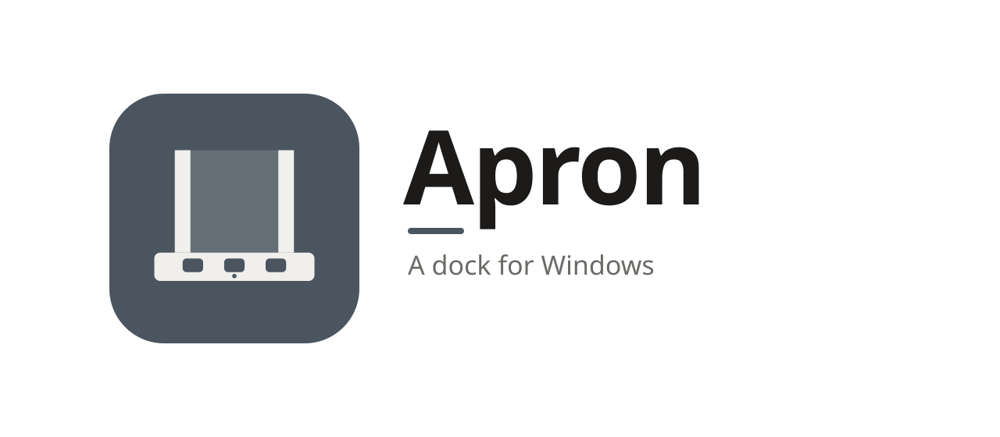
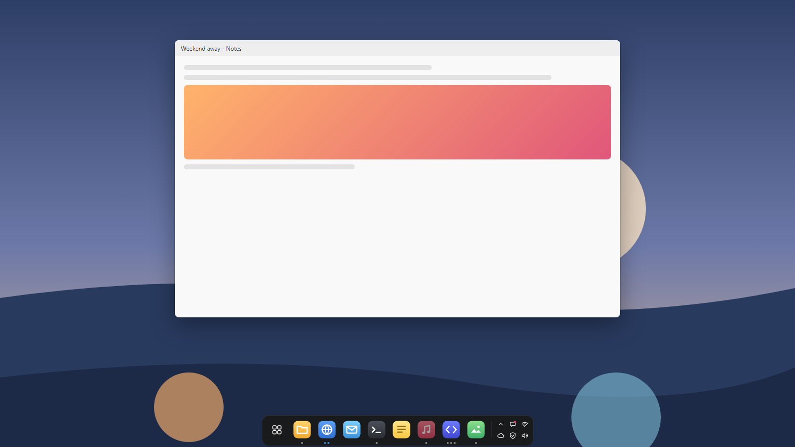
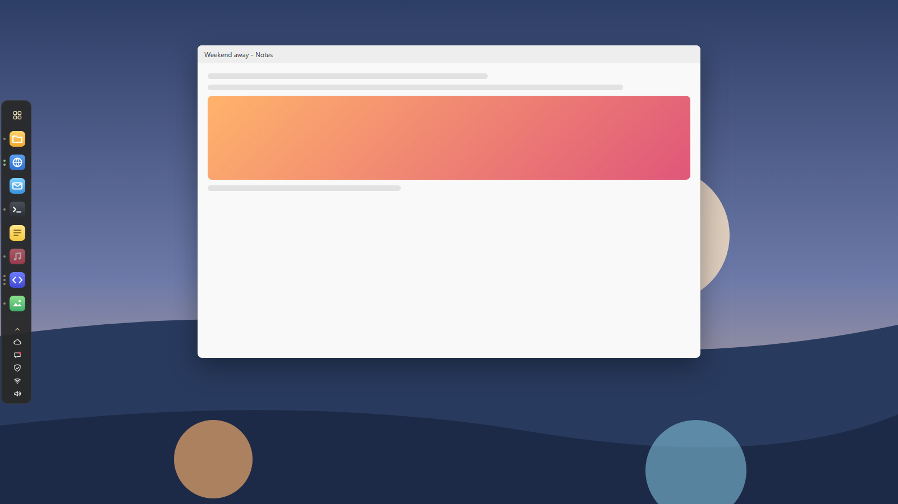
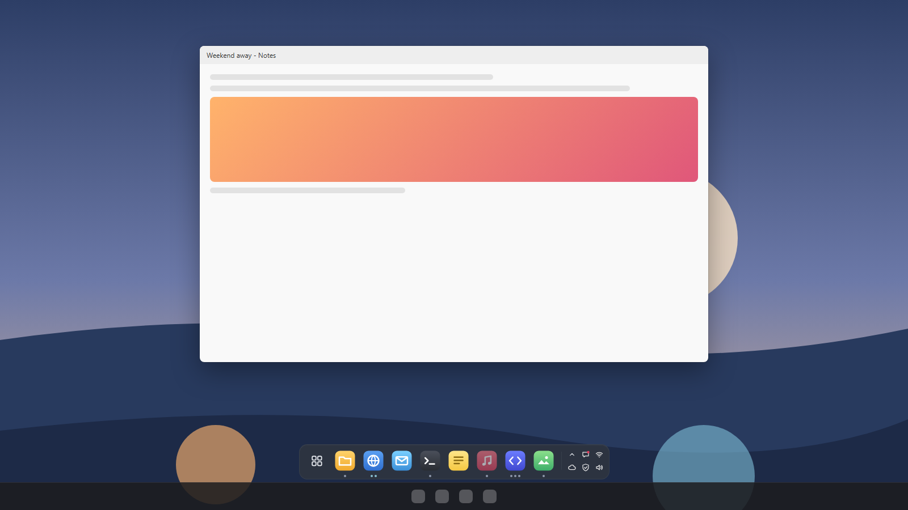
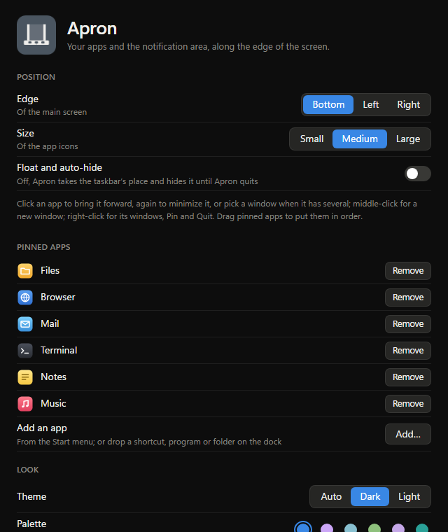
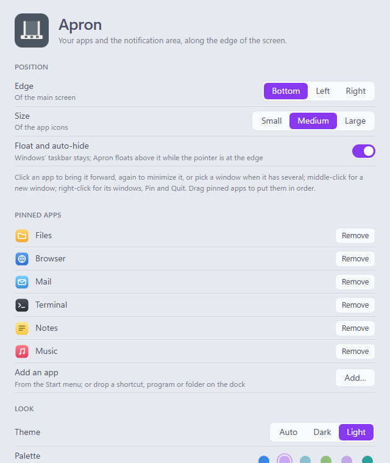

<picture>
  <source media="(prefers-color-scheme: dark)" srcset="assets/banner-dark.svg">
  
</picture>

**A dock for Windows.**

Your pinned and open apps, your apps grid and the notification area, 
along the bottom of the screen in the taskbar's place.

[Install](#install) · [Using it](#using-it) · [The taskbar](#the-taskbar) · [FAQ](#faq) · [Contributing](CONTRIBUTING.md)

<picture>
  <source media="(prefers-color-scheme: light)" srcset="docs/images/dock-light.png">
  
</picture>

The taskbar does a lot of things at once: Start, search, widgets, the apps you pinned, the windows
you have open, the clock. Apron does fewer, and keeps them calm: the apps you use, a dot under each
one that's open, and the notification area's icons, on a shelf in the middle of the edge.

## Why Apron

- **Your apps, pinned and open.** Pinned apps keep their place; open ones join them at the end
  until you close them. A dot under an app for each of its windows (up to four), the one in front
  in your palette's colour.
- **One click.** Click an app to bring it to the front, or minimize it if it's already there, or
  open it if it isn't. With several windows open, pick one. Middle-click for a new window.
  Right-click for its windows, **New window**, **Pin** or **Unpin**, and **Quit**.
- **Your choice of apps.** Pin any app from the Start menu in Apron's settings, or drop a shortcut,
  program or folder on the dock. Remove them there too.
- **The notification area too.** The icons apps put by the clock sit at Apron's right end, and
  answer clicks as they do on the taskbar. The ones Windows keeps out of sight are under **^**.
- **Your apps grid.** The first button opens [Fanlight](../fanlight/README.md)'s Apps grid, every
  app you have at once.
- **Taskbar or not.** Apron takes the taskbar's place, and gives it back when it quits. Or keep the
  taskbar and have Apron float above it when you push the pointer to the edge.
- **Private.** No account, no telemetry, and it never goes online. See [SECURITY.md](SECURITY.md).
- **Looks like it belongs.** Six palettes, each in dark and light, solid or glass, and Auto to
  follow Windows: the same ones as [Oriel](../oriel/README.md), [Lintel](../lintel/README.md),
  [Fanlight](../fanlight/README.md), [Bay](../bay/README.md), [Sash](../sash/README.md) and
  [Mitre](../mitre/README.md).

## Using it

| | |
| --- | --- |
| Click an app | Bring it to the front; minimize it if it's in front; open it if it isn't open. With several windows, a menu of them |
| Drop a file on the dock | A shortcut, program or folder: pinned |
| Middle-click an app | A new window of it |
| Right-click an app | Its windows, **New window**, **Pin** or **Unpin**, and **Quit** |
| Drag a pinned app | Put it somewhere else among the pinned ones |
| Right-click the dock | **Apron Settings…**, **Float and auto-hide**, **Quit Apron** |
| The first button | Fanlight's Apps grid (greyed out until Fanlight is installed) |
| An icon at the right end | What it does on the taskbar: click, double-click or right-click |
| **^** | The notification area's icons Windows keeps out of sight |

The first time it starts, Apron pins the apps pinned to your taskbar, in the same order. **Pinned
apps** in its settings lists them, to remove one or add any app in the Start menu.

An app running as administrator (Task Manager, say) is out of Apron's reach, as Windows keeps apps
that aren't from its windows: Apron can't bring them forward, or pass on a click to their icon.
Clicking one says so, and offers to open it again, as Fanlight or Start would; one that runs once,
like Task Manager, comes to the front.

<picture>
  <source media="(prefers-color-scheme: light)" srcset="docs/images/side.png">
  
</picture>

## The taskbar

By default Apron takes the taskbar's place: it hides the taskbar and sits on the bottom edge of
your main screen (or the screen you choose), and maximized windows stop at Apron as they did at the
taskbar. Quit Apron and the
taskbar comes back, as it was. If Apron stops some other way (it crashes, or Task Manager ends it),
a small helper that waits beside it, `apron-guard.exe`, puts the taskbar back; failing that, the
next time Apron starts, it does. If Windows Explorer restarts, Apron hides the new taskbar again.

Turn on **Float and auto-hide** to keep the taskbar instead. Apron then floats above it, out of
sight until you push the pointer to the edge, and slides away when the pointer leaves.

<picture>
  <source media="(prefers-color-scheme: light)" srcset="docs/images/float.png">
  
</picture>

## Install

Apron runs on Windows 10 and 11.

1. Download **Apron-*version*-setup.exe** from the [latest release](https://github.com/Aduneer/Mullion/releases/latest), or
   **Mullion-*version*-setup.exe** there to pick from all of Mullion's apps at once (with Fanlight,
   for the apps grid, and Lintel, for a clock).
2. Run it. It installs just for you, with no admin prompt, and adds Apron to the Start menu.
3. Start Apron. It takes the taskbar's place at once; its settings are in its icon's menu.

Prefer not to install anything? Download **Apron-*version*-portable.zip** instead, unzip it into a
folder of its own (not straight into Downloads) and run `apron.exe`. Keep `apron-guard.exe` beside
it: it's what puts the taskbar back if Apron stops unexpectedly.

> [!IMPORTANT]
> Apron isn't code-signed yet, so Windows doesn't know who made it:
> - **SmartScreen** may say *Windows protected your PC*. Click **More info**, then **Run anyway**.
> - **Smart App Control**, if it's on, may block Apron: it only lets unsigned apps run when
>   Microsoft's cloud service judges them safe, and it has no "run anyway". It judges each file
>   on its own, so if it blocks the portable zip, try the installer. If it blocks that too, you
>   can [build Apron yourself](CONTRIBUTING.md#building-from-source) until it's signed.
>   Please don't turn Smart App Control off for Apron: on most versions of Windows it can only
>   be turned back on by reinstalling Windows.
>
> Each release lists the SHA-256 of its files in `SHA256SUMS.txt`, so you can check a download
> with `Get-FileHash`.

To uninstall, go to **Settings → Apps → Installed apps → Apron**. It quits Apron first, so the
taskbar comes back. Tick **Delete the application data** to also remove your settings and the
sign-in entry.

## Settings

**Settings…** in the notification-area menu, or **Apron Settings…** when you right-click the dock.
Changes apply and save as you make them, to `%APPDATA%\Apron\settings.json`:

- **Screen**: with more than one, which the dock is on (the main one until you choose; and again
  while the one you chose isn't plugged in)
- **Edge**: bottom, left or right, of that screen
- **Size**: small, medium or large icons
- **Float and auto-hide**: keep the taskbar, and float above it at the edge
- **Theme**: Auto, dark or light, a **palette**, and **Glass**: the wallpaper, blurred, behind the
  dock
- **Start at sign-in**

  
  

## Part of Mullion

Apron is one of [Mullion](https://github.com/Aduneer/Mullion)'s apps, which rework the Windows
desktop, with [Oriel](../oriel/README.md), the dashboard for your second screen,
[Lintel](../lintel/README.md), the menu bar, [Fanlight](../fanlight/README.md), search and launch,
whose Apps grid is Apron's first button, [Bay](../bay/README.md), every window at once,
[Sash](../sash/README.md), windows snapped from the keyboard, and [Mitre](../mitre/README.md), hot
corners. They share their themes, and Mullion's installer installs any of them in one go. Each is
still its own program, which works alone.

With Lintel's bar and Apron's dock both running from Mullion, your open apps are in the dock, so
the bar leaves them out (tick **Open apps** in Lintel's settings to have them in both).

## FAQ

**Why is it called Apron?**
An apron is the trim just under a window's sill, the lowest part of the frame, so it sits along the bottom of the screen. It's also where planes park at an airport, which suits a dock.

**Where's the clock?**
Not in Apron: the dock keeps to your apps. [Lintel](../lintel/README.md)'s menu bar has one, and
the two are made to go together. Or turn on **Float and auto-hide**, and the taskbar keeps its
clock.

**And Start?**
The <kbd>Win</kbd> key still opens Windows' Start menu. Apron's first button opens Fanlight's Apps
grid, and <kbd>Alt</kbd> + <kbd>Space</kbd> Fanlight's search.

**An icon in the notification area is hard to see.**
Apps draw their icons for Windows' own light or dark (**Settings → Personalization → Colors →
Choose your default Windows mode**). If Apron's theme is the other one, set Apron's theme to Auto,
or Windows' mode to match it.

**An app's icon isn't at the right end.**
Some apps add their icon only when they start, or only after Explorer tells them the taskbar is
there: Apron tells them as it starts. Quit the app and start it again. If it's still missing, please
[say which app](https://github.com/Aduneer/Mullion/issues/new/choose).

**Can I have the dock on another screen?**
Yes: **Screen** in Apron's settings. There's one dock, on the screen you choose; the taskbars on
every screen are hidden while Apron replaces them.

**It doesn't show over a game.**
On purpose: while a full-screen app or game is in front, Apron steps out of the way.

**Does it go online?**
No. The one button that opens GitHub in your browser says so.

**Why isn't it signed?**
Code signing needs a paid certificate and an identity check. It's planned.

## Roadmap

- A dock on every screen
- Magnification as the pointer passes over the icons
- Signed releases, then winget

Something you'd like to see? Say so in [Discussions](https://github.com/Aduneer/Mullion/discussions).

## Contributing

Bug reports, ideas and pull requests are welcome: [open an issue](https://github.com/Aduneer/Mullion/issues/new/choose) for a
bug, or start a [discussion](https://github.com/Aduneer/Mullion/discussions) for an idea or a question.
[CONTRIBUTING.md](CONTRIBUTING.md) covers building from source, how Apron works and working on its
pages in a browser without building the Rust side.

## License

[MIT](LICENSE)

The palettes other than the Default one (Oriel's own) are adapted from [Catppuccin](https://catppuccin.com),
[Nord](https://www.nordtheme.com), [Gruvbox](https://github.com/morhetz/gruvbox),
[Rosé Pine](https://rosepinetheme.com) and [Solarized](https://ethanschoonover.com/solarized/),
all MIT licensed.
