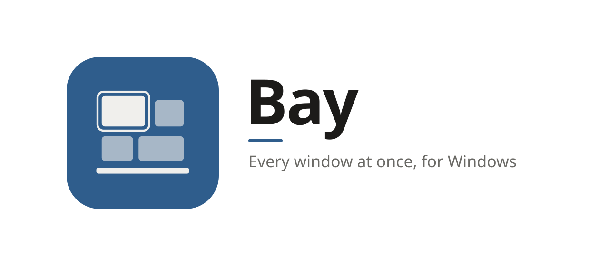
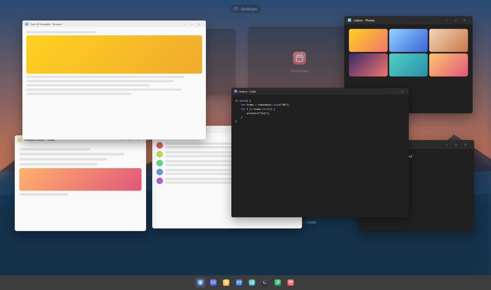
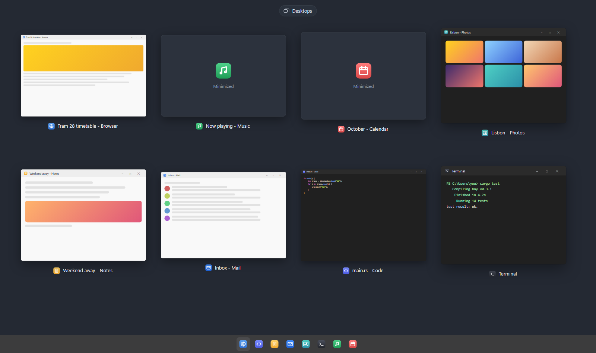
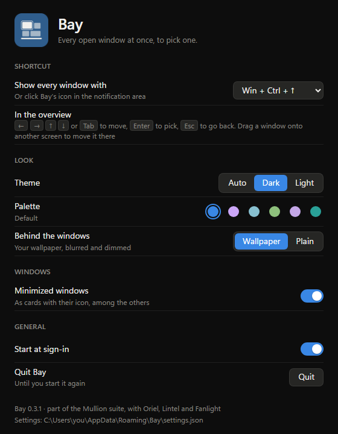
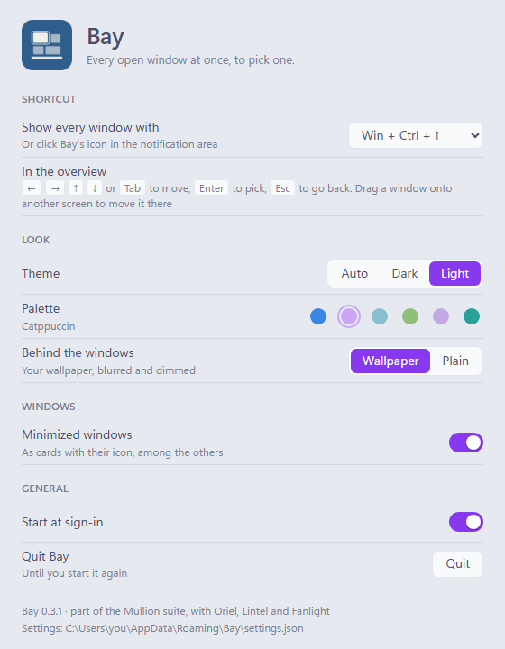

<picture>
  <source media="(prefers-color-scheme: dark)" srcset="assets/banner-dark.svg">
  
</picture>

**Every window at once, for Windows.**

Press <kbd>Win</kbd> + <kbd>Ctrl</kbd> + <kbd>↑</kbd> and every open window steps back into a grid, 
live, over your blurred wallpaper. Pick the one you want, or drag one to another screen.

[Install](#install) · [Using it](#using-it) · [Screens and desktops](#screens-and-desktops) · [Keys](#keys) · [FAQ](#faq) · [Contributing](CONTRIBUTING.md)

<picture>
  <source media="(prefers-color-scheme: light)" srcset="docs/images/overview-light.png">
  
</picture>

On a Mac, one key spreads every open window out so you can see them all and pick one. Windows has
Task View on <kbd>Win</kbd> + <kbd>Tab</kbd>, but it's a page of its own: the screen goes grey,
the windows jump to a list, and it's as much about desktops as windows. Bay is the other kind:
the windows you were just looking at slide apart where they are, so you can see where each went,
and slide back when you've picked one.

## Why Bay

- **Live.** Every window is a live picture from Windows itself, not a screenshot: a video keeps
  playing, a build keeps scrolling.
- **Nothing jumps.** The overview opens over the screen exactly as it was, then the windows fly to
  their places while the desktop fades to your wallpaper, blurred and dimmed. Closing runs it
  backwards, and the window you picked lands on top.
- **Windows stay near where they were.** The grid keeps each window on the side of the screen it
  was on, and rows in the order they were in, so you find things where you left them.
- **Every screen.** Each screen gets its own overview with its own windows. Drag a window from one
  to another to move it there.
- **Quick to reach.** A shortcut that's free in Windows (<kbd>Win</kbd> + <kbd>Ctrl</kbd> +
  <kbd>↑</kbd>), or a click on its icon.
- **Private.** No account, no telemetry, and it never goes online. See [SECURITY.md](SECURITY.md).
- **Looks like it belongs.** Six palettes, each in dark and light, and Auto to follow Windows:
  the same ones as [Oriel](../oriel/README.md), [Lintel](../lintel/README.md) and
  [Fanlight](../fanlight/README.md).

## Using it

Press <kbd>Win</kbd> + <kbd>Ctrl</kbd> + <kbd>↑</kbd>, or click Bay's icon in the notification
area. Every window that's open (the ones <kbd>Alt</kbd> + <kbd>Tab</kbd> lists) moves into a grid
on its own screen, with its icon and title below it. Hover over one, or move with the arrow keys,
and a ring shows which; click it or press <kbd>Enter</kbd>, and it comes forward with the pointer
in its middle. <kbd>Esc</kbd>, the shortcut again, or a click beside the windows puts everything
back as it was.

**Minimized windows** show as cards with their icon, in the grid with the others, because Windows
keeps no picture of a minimized window to show. Pick one and it comes back. If you'd rather not
see them, turn off **Minimized windows** in Settings.

**Behind the windows** is your wallpaper, blurred and dimmed in the palette's colour, as Windows
fits it to each screen. Prefer a plain background? Pick **Plain** in Settings.

## Screens and desktops

With more than one screen, each has its own overview, laid out for that screen. <kbd>Tab</kbd>
goes through the windows on one, then on to the next; <kbd>←</kbd> and <kbd>→</kbd> carry on to
the next screen past the last window on a side.

**Drag a window onto another screen** to move it there. It goes to the same place on the new
screen, kept inside it and no bigger, and a maximized window is maximized there. Both screens'
grids make room. Minimized windows stay where they are, and so do windows of programs running as
administrator (Task Manager, for one): Windows doesn't let other programs move those, and Bay says
so rather than pretending.

**Desktops** are Windows' own. The **Desktops** button at the top of the overview closes Bay and
opens Windows' Task View, where you make desktops, switch between them, and drag windows from one
to another. Bay doesn't move windows between desktops itself: Windows only lets a program do that
with interfaces it doesn't document, which change from one version of Windows to the next.

## Keys

| Key | What it does |
| --- | --- |
| <kbd>Win</kbd> + <kbd>Ctrl</kbd> + <kbd>↑</kbd> | Open or close Bay (you can pick another shortcut) |
| <kbd>←</kbd> <kbd>→</kbd> <kbd>↑</kbd> <kbd>↓</kbd> | The nearest window that way; past the edge, the next screen |
| <kbd>Tab</kbd>, <kbd>Shift</kbd> + <kbd>Tab</kbd> | The next window, in reading order, then the next screen |
| <kbd>Enter</kbd>, a click | Bring that window forward |
| A drag onto another screen | Move the window there |
| <kbd>Esc</kbd>, a click beside the windows | Put everything back |

## Install

Bay runs on Windows 10 and 11.

1. Download **Bay-*version*-setup.exe** from the [latest release](https://github.com/Aduneer/Mullion/releases/latest), or
   **Mullion-*version*-setup.exe** there to pick from all of Mullion's apps at once.
2. Run it. It installs just for you, with no admin prompt, and adds Bay to the Start menu.
3. Start Bay. It waits in the notification area; press <kbd>Win</kbd> + <kbd>Ctrl</kbd> +
   <kbd>↑</kbd>.

Prefer not to install anything? Download **Bay-*version*-portable.zip** instead, unzip it into a
folder of its own (not straight into Downloads) and run `bay.exe`.

> [!IMPORTANT]
> Bay isn't code-signed yet, so Windows doesn't know who made it:
> - **SmartScreen** may say *Windows protected your PC*. Click **More info**, then **Run anyway**.
> - **Smart App Control**, if it's on, may block Bay: it only lets unsigned apps run when
>   Microsoft's cloud service judges them safe, and it has no "run anyway". It judges each file
>   on its own, so if it blocks the portable zip, try the installer. If it blocks that too, you
>   can [build Bay yourself](CONTRIBUTING.md#building-from-source) until it's signed.
>   Please don't turn Smart App Control off for Bay: on most versions of Windows it can only
>   be turned back on by reinstalling Windows.
>
> Each release lists the SHA-256 of its files in `SHA256SUMS.txt`, so you can check a download
> with `Get-FileHash`.

To uninstall, go to **Settings → Apps → Installed apps → Bay**. Tick
**Delete the application data** to also remove your settings and the sign-in entry.

## Settings

**Settings…** in the notification-area menu. Changes apply and save as you make them, to
`%APPDATA%\Bay\settings.json`:

- **Shortcut**: <kbd>Win</kbd> + <kbd>Ctrl</kbd> + <kbd>↑</kbd>, <kbd>Win</kbd> + <kbd>Shift</kbd>
  + <kbd>Tab</kbd>, <kbd>Ctrl</kbd> + <kbd>Alt</kbd> + <kbd>↑</kbd> or <kbd>Ctrl</kbd> +
  <kbd>↑</kbd>
- **Theme**: Auto, dark or light, and a **palette**
- **Behind the windows**: your wallpaper, or the palette's plain colour
- **Minimized windows**, as cards or not at all
- **Start at sign-in**

  
  

## Part of Mullion

Bay is one of [Mullion](https://github.com/Aduneer/Mullion)'s apps, which rework the Windows desktop, with
[Oriel](../oriel/README.md), the dashboard for your second screen,
[Lintel](../lintel/README.md), the menu bar, [Fanlight](../fanlight/README.md), search and
launch, and [Sash](../sash/README.md), windows snapped from the keyboard. They share their themes, and Mullion's installer installs any of them in one go. Each is
still its own program, which works alone.

## FAQ

**Why Win + Ctrl + ↑?**
It's free in Windows, and it's the arrow that means "show me everything" elsewhere. Windows keeps
<kbd>Win</kbd> + <kbd>Tab</kbd> for Task View and <kbd>Win</kbd> + <kbd>↑</kbd> for maximizing,
and Fanlight has <kbd>Alt</kbd> + <kbd>Space</kbd>. Pick another in Settings if you like.

**It says the shortcut is taken.**
Another app has it. Pick another shortcut in Settings, or change that app's.

**A window I have open isn't there.**
Bay shows the windows <kbd>Alt</kbd> + <kbd>Tab</kbd> shows: not tool windows, windows on other
desktops, or ones a program keeps hidden. Minimized ones show unless you turned them off.

**Does it slow my PC down?**
It does nothing until you open it. Its windows are made when it starts and wait hidden, so it
opens at once. The pictures of the windows are drawn by Windows' compositor (DWM), on the
graphics card, not by Bay. No admin rights, drivers or services.

**Does it go online?**
No.

**Why isn't it signed?**
Code signing needs a paid certificate and an identity check. It's planned.

## Roadmap

- The overview from a hot corner, or a mouse button
- Windows that open or close while Bay is open, added and taken away as it happens
- Signed releases, then winget

Something you'd like to see? Say so in [Discussions](https://github.com/Aduneer/Mullion/discussions).

## Contributing

Bug reports, ideas and pull requests are welcome: [open an issue](https://github.com/Aduneer/Mullion/issues/new/choose) for a
bug, or start a [discussion](https://github.com/Aduneer/Mullion/discussions) for an idea or a question.
[CONTRIBUTING.md](CONTRIBUTING.md) covers building from source, how Bay works and working on the
overview in a browser without building the Rust side.

## License

[MIT](LICENSE)

The palettes other than the Default one (Oriel's own) are adapted from [Catppuccin](https://catppuccin.com),
[Nord](https://www.nordtheme.com), [Gruvbox](https://github.com/morhetz/gruvbox),
[Rosé Pine](https://rosepinetheme.com) and [Solarized](https://ethanschoonover.com/solarized/),
all MIT licensed.
