

<picture>
  <source media="(prefers-color-scheme: dark)" srcset="assets/banner-dark.svg">
  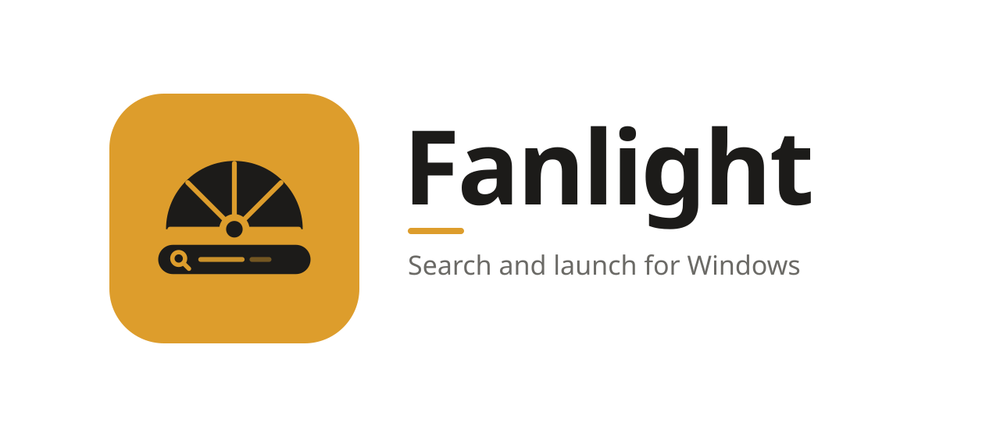
</picture>

**Search and launch for Windows.**

Press <kbd>Alt</kbd> + <kbd>Space</kbd> and type: apps, files, settings, open windows, sums, 
what you copied and the web, in one field that opens over whatever you're doing.

[Install](#install) · [What it finds](#what-it-finds) · [App grid](#app-grid) · [Keys](#keys) · [FAQ](#faq) · [Contributing](CONTRIBUTING.md)

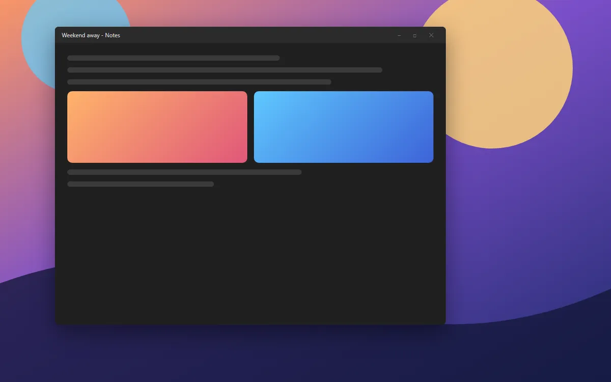

On a Mac, <kbd>⌘</kbd> + <kbd>Space</kbd> opens a field that finds anything: an app, a file, a
setting, the answer to a sum. Windows has search in the Start menu, but it's slow to open, mixes
in web results you didn't ask for, and can't do much with what it finds. Fanlight is that field
for Windows: it opens at once, finds things as you type, and every result does something when you
press <kbd>Enter</kbd>.

## Why Fanlight

- **Fast.** It keeps its own index of your folders in memory and brings it up to date each time it
  opens, so results come with each keystroke, even with tens of thousands of files. It doesn't use
  Windows Search or its indexer.
- **Learns what you pick.** Things you open often and lately rank higher, and what you picked for
  a query comes first the next time you type it.
- **More than search.** Do sums and convert units, switch to an open window, paste something you
  copied an hour ago, lock or restart the PC, open a Settings page, or search the web.
- **Look before you open.** <kbd>Space</kbd> shows the selected result beside the list: a photo,
  the start of a document, what's in a folder, a clipboard entry in full.
- **Private.** No account, no telemetry, and it never goes online by itself; web searches open in
  your browser when you pick them. See [SECURITY.md](SECURITY.md).
- **Looks like it belongs.** Six palettes, each in dark and light, and Auto to follow Windows.
  The same ones as [Oriel](https://github.com/Aduneer/Oriel) and
  [Lintel](https://github.com/Aduneer/Lintel). Solid, or glass that blurs what's behind it.

## What it finds

<picture>
  <source media="(prefers-color-scheme: light)" srcset="docs/images/search-light.png">
  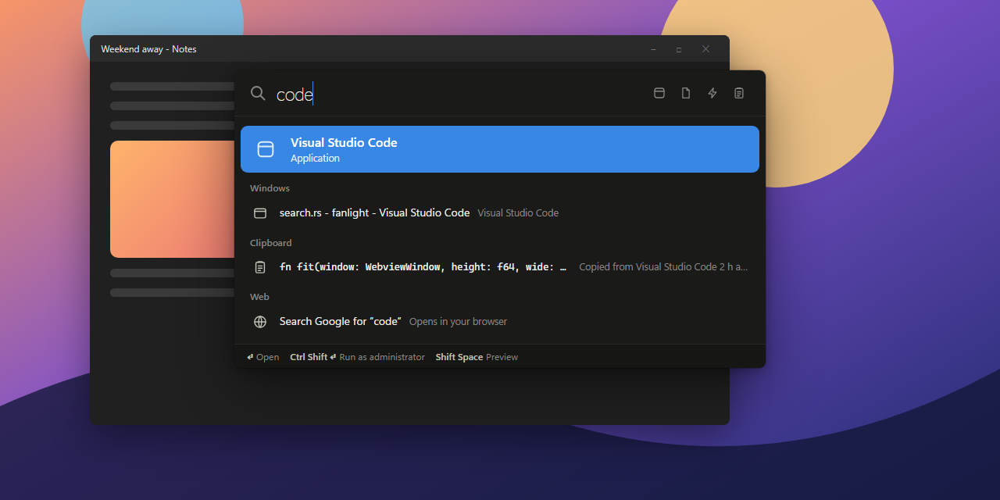
</picture>

The best match of them all is the **Top Hit**; the rest are grouped below it:

- **Applications**: everything in the Start menu, Store apps included, by name or initials
  (*vsc* for Visual Studio Code).
- **Commands**: Lock, Sleep, Sign out, Restart, Shut down, Show desktop, Take a screenshot, Emoji,
  Clipboard history and Fanlight's own. Sign out, Restart and Shut down ask for a second
  <kbd>Enter</kbd> first.
- **System Settings**: about sixty pages of Windows' Settings, by the words people use for them
  (*wallpaper*, *dark mode*, *uninstall*).
- **Windows**: the windows that are open, to switch to by their title or their app's name.
- **Clipboard**: text you copied, to paste again.
- **Folders** and **Documents**: by name, from your Desktop, Documents, Downloads, Pictures, Music
  and Videos, and any other folders you add in Settings.
- **Web**: always last, a search with the engine you pick. Start with <kbd>?</kbd> to go straight
  to it.

Type a sum and its answer is the Top Hit: `(1200+340)*1.2`, `2^10`, `80 * 15%`, `sqrt(2)`,
`5!`. It converts units too: `10 km in mi`, `72 f to c`, `3 cups in ml`, `1.5 gb in mb`.
<kbd>Enter</kbd> copies the answer. Type a web address to open it, or a path (`C:\Users`,
`~\Downloads`, `%APPDATA%`) to open that folder.

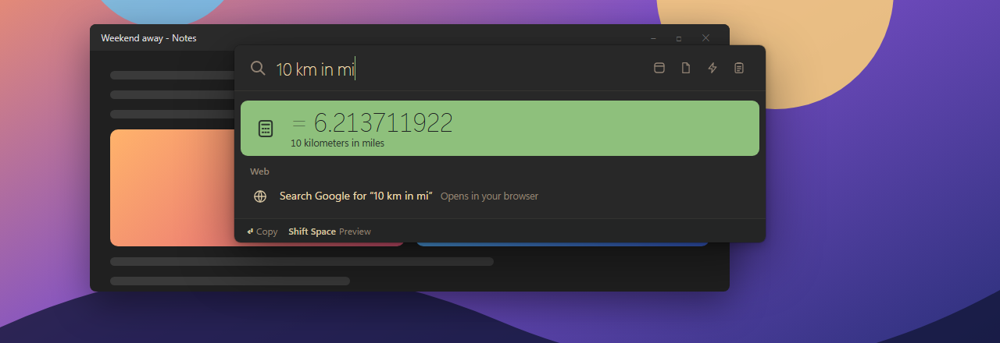

## Preview

Move to a result with the arrow keys and press <kbd>Space</kbd>, or <kbd>Shift</kbd> +
<kbd>Space</kbd> at any time. The panel widens, and the selected result shows beside the list. It
follows as you move up and down; <kbd>Space</kbd> or <kbd>Esc</kbd> closes it.

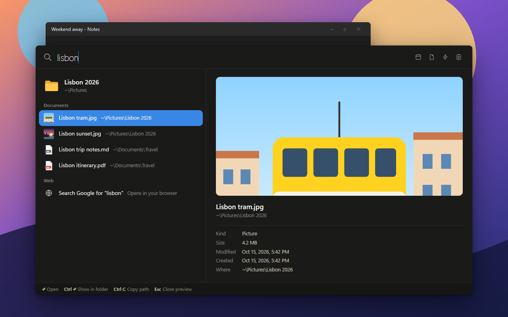

Pictures and videos show large, text and code files show their first lines, folders list what's in
them, and clipboard entries show in full. Everything shows its facts: kind, size, when it was
changed and made, and where it is. Files that are only in OneDrive, not on the PC, aren't opened,
so a preview never downloads anything.

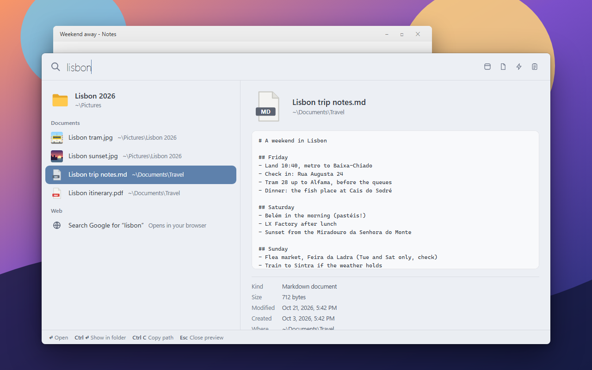

## Categories

The four buttons in the field, or <kbd>Ctrl</kbd> + <kbd>1</kbd> to <kbd>4</kbd>, keep the
search to one kind of result, and show more of it: **Apps** (and their windows), **Files** (and
folders), **Actions** (commands and Settings pages) and **Clipboard**. With nothing typed, a
category lists everything in it. <kbd>Backspace</kbd> in an empty field or <kbd>Esc</kbd> goes
back to everything.

## App grid

The Apps category (<kbd>Ctrl</kbd> + <kbd>1</kbd>) shows your apps as a grid of icons, as
Launchpad does on a Mac: every app in the Start menu, in alphabetical order, with your open windows
under them. Type to narrow it down, move with the arrow keys and press <kbd>Enter</kbd>. Prefer a
list? Settings → **Apps** → List.

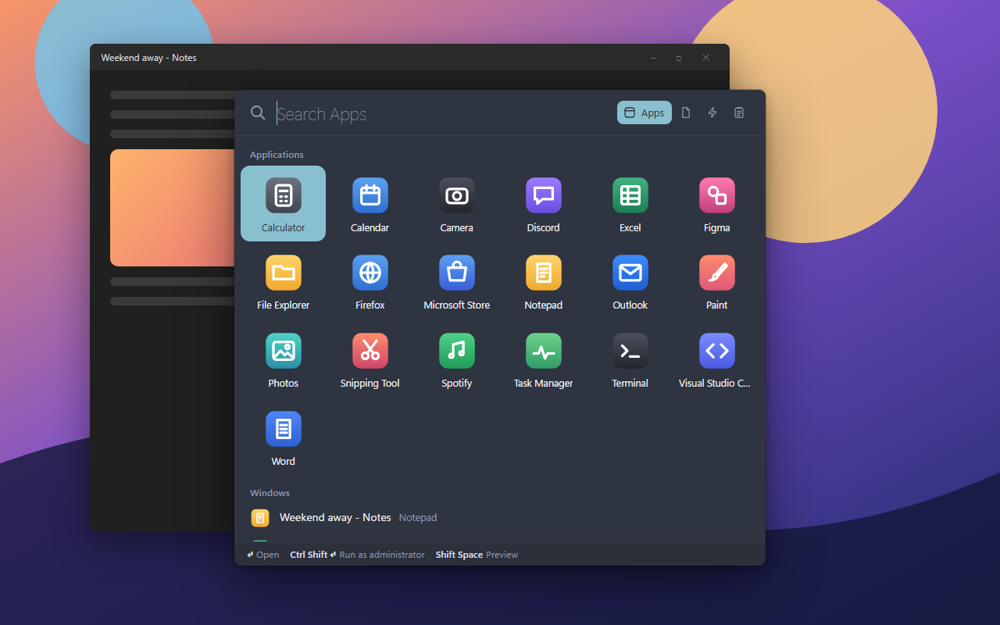

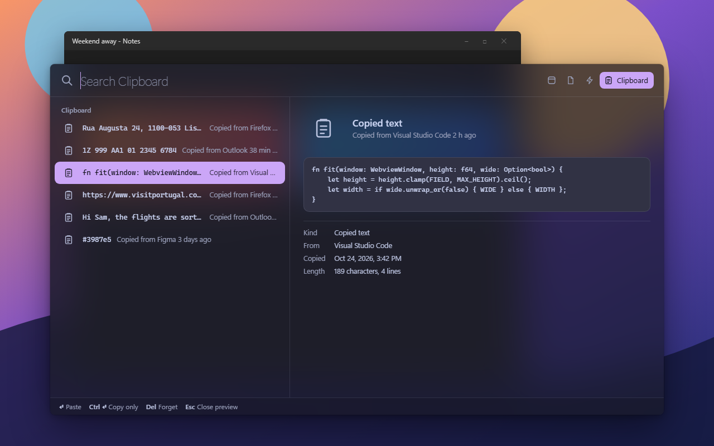

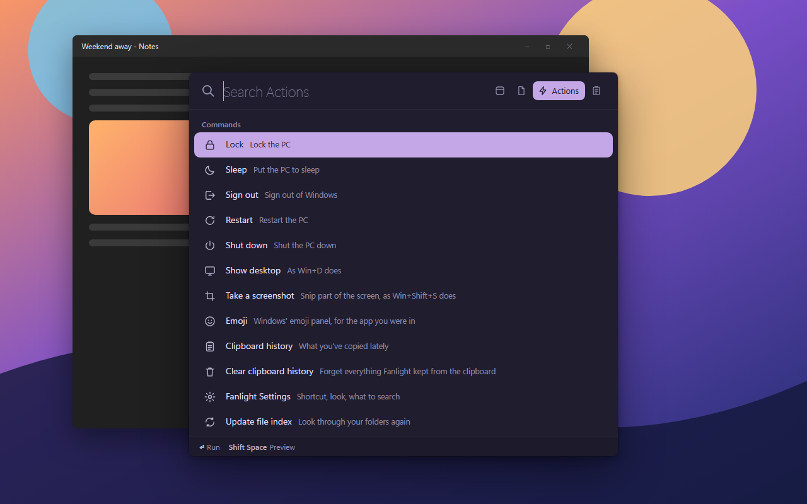

## Keys

| Key | What it does |
| --- | --- |
| <kbd>Alt</kbd> + <kbd>Space</kbd> | Open or close Fanlight (you can pick another shortcut) |
| <kbd>↑</kbd> <kbd>↓</kbd>, <kbd>Tab</kbd> | Move through the results (and <kbd>←</kbd> <kbd>→</kbd> in the apps' grid) |
| <kbd>Enter</kbd> | Open, run, switch to, paste, copy the answer |
| <kbd>Ctrl</kbd> + <kbd>Enter</kbd> | Show a file in its folder; copy a clipboard entry without pasting |
| <kbd>Ctrl</kbd> + <kbd>Shift</kbd> + <kbd>Enter</kbd> | Run an app as administrator |
| <kbd>Ctrl</kbd> + <kbd>C</kbd> | Copy a file's path, an answer or an address |
| <kbd>Space</kbd>, <kbd>Shift</kbd> + <kbd>Space</kbd> | Preview |
| <kbd>Ctrl</kbd> + <kbd>1</kbd> to <kbd>4</kbd> | Apps, Files, Actions, Clipboard |
| <kbd>↑</kbd> in an empty field | Earlier searches, as in a terminal; <kbd>Ctrl</kbd> + <kbd>↓</kbd> goes forward again |
| <kbd>Delete</kbd> | Forget a clipboard entry |
| <kbd>Ctrl</kbd> + <kbd>,</kbd> | Settings |
| <kbd>Esc</kbd> | Close the preview, clear the field, leave the category, then close |

Clicking anywhere else closes Fanlight too. What you typed stays, selected, for next time: type to
replace it, or press <kbd>Enter</kbd> to open the same thing again.

## Install

Fanlight runs on Windows 10 and 11.

1. Download **Fanlight-*version*-setup.exe** from the [latest release](../../releases/latest).
2. Run it. It installs just for you, with no admin prompt, and adds Fanlight to the Start menu.
3. Start Fanlight. It waits in the notification area; press <kbd>Alt</kbd> + <kbd>Space</kbd>.

Prefer not to install anything? Download **Fanlight-*version*-portable.zip** instead, unzip it
into a folder of its own (not straight into Downloads) and run `fanlight.exe`.

> [!IMPORTANT]
> Fanlight isn't code-signed yet, so Windows doesn't know who made it:
> - **SmartScreen** may say *Windows protected your PC*. Click **More info**, then **Run anyway**.
> - **Smart App Control**, if it's on, may block Fanlight: it only lets unsigned apps run when
>   Microsoft's cloud service judges them safe, and it has no "run anyway". It judges each file
>   on its own, so if it blocks the portable zip, try the installer. If it blocks that too, you
>   can [build Fanlight yourself](CONTRIBUTING.md#building-from-source) until it's signed.
>   Please don't turn Smart App Control off for Fanlight: on most versions of Windows it can only
>   be turned back on by reinstalling Windows.
>
> Each release lists the SHA-256 of its files in `SHA256SUMS.txt`, so you can check a download
> with `Get-FileHash`.

To uninstall, go to **Settings → Apps → Installed apps → Fanlight**. Tick
**Delete the application data** to also remove your settings, history and the sign-in entry.

## Settings

<kbd>Ctrl</kbd> + <kbd>,</kbd> in the panel, **Settings…** in the notification-area menu, or type
*settings*. Changes apply and save as you make them, to `%APPDATA%\Fanlight\settings.json`:

- **Shortcut**: <kbd>Alt</kbd> + <kbd>Space</kbd>, <kbd>Ctrl</kbd> + <kbd>Space</kbd>, and a
  few more
- **Theme**: Auto, dark or light; a **palette**; and **glass**
- **Files and folders**, on or off, and more folders to search
- **Open windows**, on or off
- **Apps**: the Apps category as a grid or a list
- **Search the web with** Google, Bing, DuckDuckGo, Brave Search, Ecosia, Startpage or Kagi
- **Clipboard history**, on or off, how much it keeps, and whether it's kept after Fanlight quits
- **Start at sign-in**
- **Forget what you've opened**, and **update the file index** now

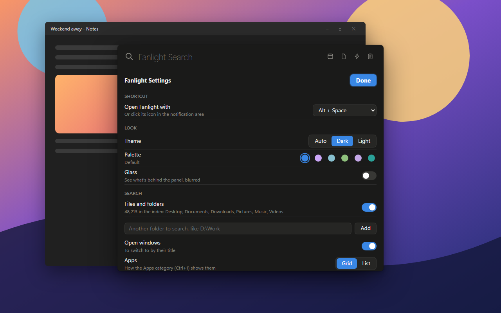

With **glass**, the panel is see-through and blurs what's behind it, the way Start and the quick
settings do:

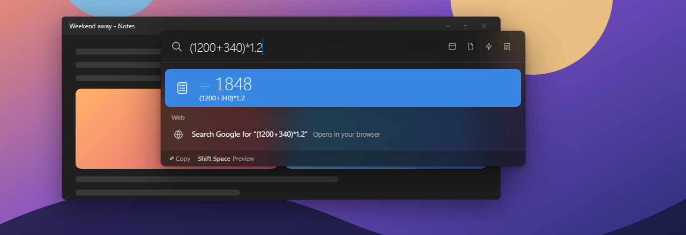

## Part of Mullion

Fanlight is one of a set of apps that rework the Windows desktop, with
[Oriel](https://github.com/Aduneer/Oriel), the dashboard for your second screen, and
[Lintel](https://github.com/Aduneer/Lintel), the menu bar. They share their themes. One installer
for all of them is on the roadmap.

## FAQ

**Alt + Space opens a window's menu in Windows. Does Fanlight take that away?**
While Fanlight runs, yes: it takes the shortcut for itself, as Spotlight's is ⌘ + Space on a Mac.
The window menu is still on a right-click of any title bar. If you'd rather keep it, pick another
shortcut in Settings.

**It says the shortcut is taken.**
Another app has it, often PowerToys Run (also <kbd>Alt</kbd> + <kbd>Space</kbd>). Pick another
shortcut in Settings, or change that app's.

**A file I know is there doesn't show up.**
Fanlight searches your Desktop, Documents, Downloads, Pictures, Music and Videos, and the folders
you add in Settings. It leaves out hidden and system files, folders whose names start with a dot,
and build output and package caches (`node_modules`, folders marked with `CACHEDIR.TAG`). Files
it finds by name, not by what's in them.

**Does it use Windows Search or the `Searches` folder?**
No. It keeps its own index in memory, built when it starts and brought up to date each time the
panel opens, reading only the folders that changed since.

**Does the clipboard history keep my passwords?**
No. Password managers mark what they copy as private, and Fanlight leaves it out, the way Windows'
own clipboard history does. The history is in memory only unless you turn on keeping it, when it's
saved in `%APPDATA%\Fanlight\clipboard.json`. Only text is kept.

**Does it slow my PC down?**
It does nothing until you open it, besides noticing when you copy something. A debug build's own
process takes about 30 MB, file index included, plus the WebView2 processes that draw the panel.
No admin rights, drivers or services.

**Does it go online?**
No. A web search, or a web address you type, opens in your browser when you pick it.

**Why isn't it signed?**
Code signing needs a paid certificate and an identity check. It's planned.

## Roadmap

- One installer for Fanlight, Oriel, Lintel and what comes next
- Search inside documents, and more converters (currencies, time zones)
- Signed releases, then winget

Something you'd like to see? Say so in [Discussions](../../discussions).

## Contributing

Bug reports, ideas and pull requests are welcome: [open an issue](../../issues/new/choose) for a
bug, or start a [discussion](../../discussions) for an idea or a question.
[CONTRIBUTING.md](CONTRIBUTING.md) covers building from source, how Fanlight works and working on
the panel in a browser without building the Rust side.

## License

[MIT](LICENSE)

The palettes other than the Default one (Oriel's own) are adapted from [Catppuccin](https://catppuccin.com),
[Nord](https://www.nordtheme.com), [Gruvbox](https://github.com/morhetz/gruvbox),
[Rosé Pine](https://rosepinetheme.com) and [Solarized](https://ethanschoonover.com/solarized/),
all MIT licensed.
