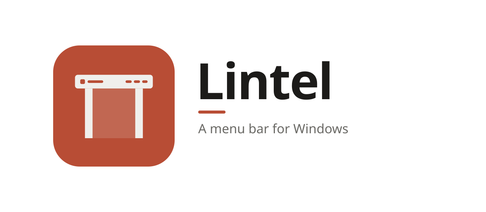
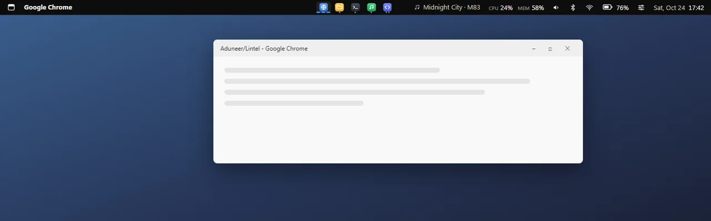
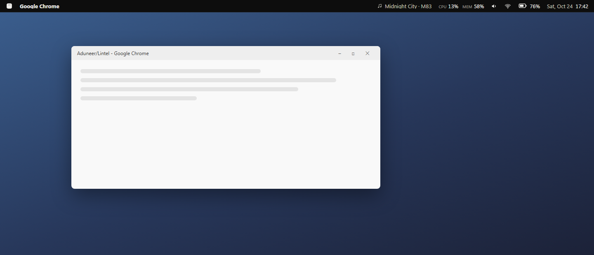
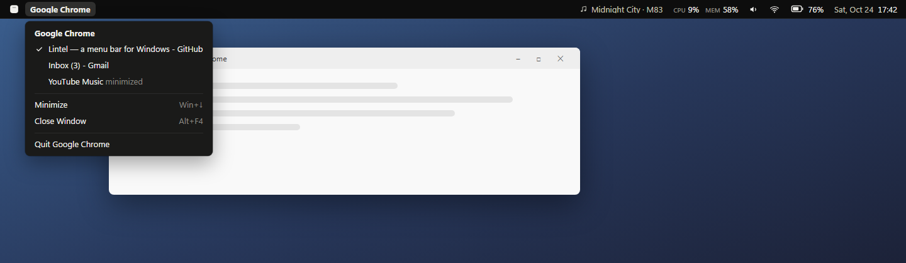
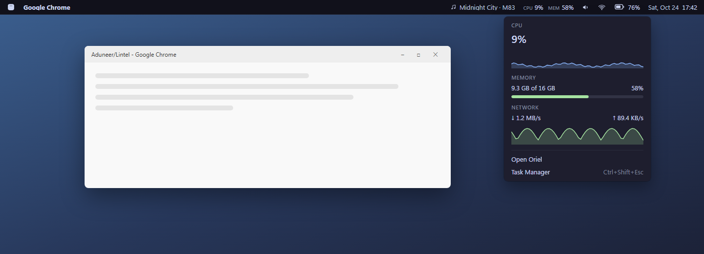
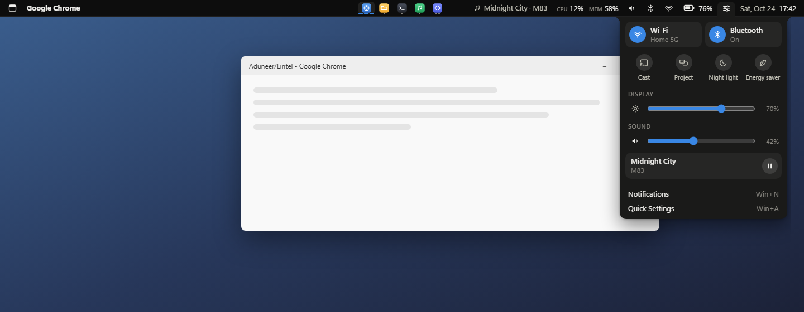
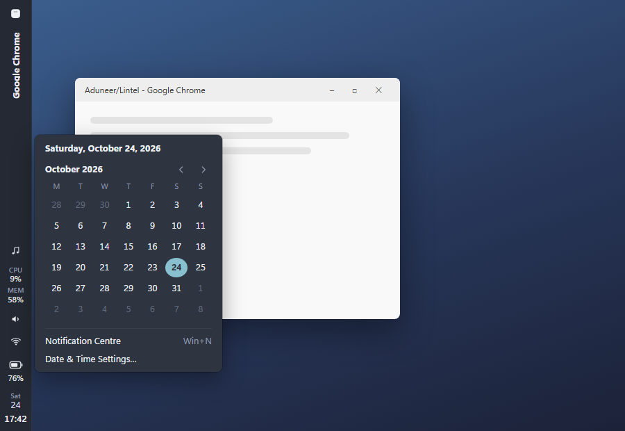
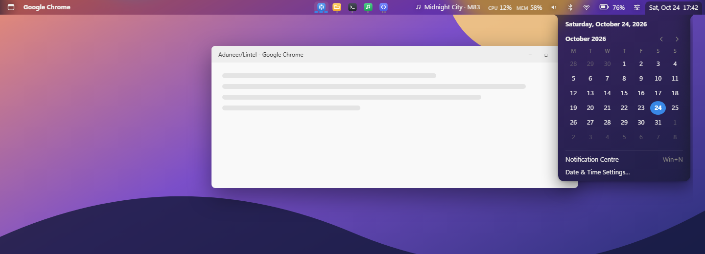

<picture>
  <source media="(prefers-color-scheme: dark)" srcset="assets/banner-dark.svg">
  
</picture>

**A menu bar for Windows.**

The app you're in, your open apps, what's playing, a Control Centre and the clock, 
in one slim bar along the top of your screen, the way macOS and Linux desktops have it.

[Install](#install) · [What's in it](#whats-in-the-bar) · [Positions and themes](#positions-and-themes) · [FAQ](#faq) · [Contributing](CONTRIBUTING.md)

On a Mac or a Linux desktop, the top of the screen tells you which app you're in and gives you
its menu, with the clock, sound, network and battery in the corner. Windows puts all of that in
the taskbar, mixed in with the app buttons, or nowhere. Lintel is that bar for Windows: thin,
always there, and every item opens a small menu that does something.

## Why Lintel

- **It takes its own space.** Lintel registers with Windows as an app bar, like the taskbar
  does, so maximized windows stop below it instead of sliding underneath. Your taskbar stays
  where it is, or tucks itself away if you'd rather.
- **Menus, not settings pages.** Click an item and its menu grows out of the bar right under
  it: skip a track, change an app's volume, turn Bluetooth off, switch to another window, see
  the month. Slide along the bar and the menu follows, reshaping into the next one; click
  anywhere else and it folds back in.
- **Out of the way.** It hides while a game or video is full screen, and it never takes the
  keyboard away from the window you're working in.
- **Private.** No account, no telemetry, and it never goes online. See [SECURITY.md](SECURITY.md).
- **Looks like it belongs.** Six palettes, each in dark and light, and Auto to follow Windows.
  The same ones as [Oriel](https://github.com/Aduneer/Oriel). Solid, or glass that shows your
  wallpaper through the bar and its menus.

## What's in the bar

<picture>
  <source media="(prefers-color-scheme: light)" srcset="docs/images/bar-light.png">
  
</picture>

From left to right:

- **The logo menu**: About This PC, System Settings, Task Manager, Sleep, Restart, Shut Down,
  Sign Out and Lock Screen, plus **Menu Bar Settings** and **Quit Lintel**. Restart, Shut Down
  and Sign Out ask first.
- **The app in front**, by name (*File Explorer*, *Terminal*, *Google Chrome*). Its menu lists
  that app's windows to switch to, and has Minimize, Close Window and Quit.
- **Your open apps**, in the middle, as the taskbar shows them, with a dot for each window. Click
  one to bring it forward (or minimize it if it's already in front, or pick a window if it has
  several), right-click for its menu, middle-click for a new window.
- **Now playing**: the track from Spotify, your browser or anything else that shows in Windows'
  media controls. The menu has the cover, play/pause, skip and how far in you are. Middle-click
  the item to play or pause.
- **CPU and memory**, with a minute of history for CPU, memory and network in the menu, and a
  shortcut to Task Manager.
- **Volume**: your output's volume and every app's, each with mute. Scroll over the item to
  change the volume without opening anything.
- **Bluetooth**: on or off, with a switch, and your paired devices, connected ones ticked.
- **Network**: Wi-Fi, wired or offline, and whether you're on the internet.
- **Battery**, on laptops: charge, whether it's plugged in and the time left.
- **The Control Centre**: Wi-Fi and Bluetooth to turn on and off, the brightness of each screen,
  the volume, what's playing, and shortcuts to Cast, Project, Night light, Energy saver,
  notifications and Windows' quick settings.
- **The clock**, 12- or 24-hour as Windows has it or as you pick, with the date and seconds if
  you want them. Its menu is a calendar that starts the week on your day.

Some of the Control Centre's shortcuts open Windows' own panel rather than switching things
themselves: Night light and Energy saver open their page in Settings, and Cast, Project,
Notifications and Quick Settings press the shortcut Windows gives them. Windows has no supported
way for an app to do more.

## Positions and themes

Lintel can sit along the **top**, **bottom**, **left** or **right** of the screen (Menu Bar
Settings → Position), on your main screen, on every screen, or on the one you pick. Down the
side, the app's name runs vertically and the clock stacks hours over minutes. Three sizes:
Compact, Standard and Large.

The palettes are Default, Catppuccin, Nord, Gruvbox, Rosé Pine and Solarized, each in dark and
light. Each comes solid or as **glass**, which shows your wallpaper, blurred, through the bar
and its menus:

## Install

Lintel runs on Windows 10 and 11.

1. Download **Lintel-*version*-setup.exe** from the [latest release](../../releases/latest).
2. Run it. It installs just for you, with no admin prompt, and adds Lintel to the Start menu.
3. Start Lintel. It takes its place along the top of your main screen; Menu Bar Settings, in the
   logo menu, moves it.

Prefer not to install anything? Download **Lintel-*version*-portable.zip** instead, unzip it
into a folder of its own (not straight into Downloads) and run `lintel.exe`.

> [!IMPORTANT]
> Lintel isn't code-signed yet, so Windows doesn't know who made it:
> - **SmartScreen** may say *Windows protected your PC*. Click **More info**, then **Run anyway**.
> - **Smart App Control**, if it's on, may block Lintel: it only lets unsigned apps run when
>   Microsoft's cloud service judges them safe, and it has no "run anyway". It judges each file
>   on its own, so if it blocks the portable zip, try the installer. If it blocks that too, you
>   can [build Lintel yourself](CONTRIBUTING.md#building-from-source) until it's signed.
>   Please don't turn Smart App Control off for Lintel: on most versions of Windows it can only
>   be turned back on by reinstalling Windows.
>
> Each release lists the SHA-256 of its files in `SHA256SUMS.txt`, so you can check a download
> with `Get-FileHash`.

To uninstall, go to **Settings → Apps → Installed apps → Lintel**. Tick
**Delete the application data** to also remove your settings and the sign-in entry.

## Using it

Click an item to open its menu; click it again, press <kbd>Esc</kbd> or click anywhere else to
close it. With a menu open, moving along the bar opens the next one. In a menu, the arrow keys
move and <kbd>Enter</kbd> picks. Middle-click the track to play or pause, and scroll over the
volume to change it.

To quit, open the logo menu and choose **Quit Lintel**. The space it reserved goes back to your
windows.

## Settings

Logo menu → **Menu Bar Settings**. Changes apply and save as you make them, to
`%APPDATA%\Lintel\settings.json`:

- **Appearance**: Auto, light or dark
- **Material**: solid or glass
- **Palette**
- **Screens**, with more than one: the main one, all of them, or one you pick
- **Position**: top, bottom, left or right
- **Size**: Compact, Standard or Large
- **Clock**: Windows' format, 12-hour or 24-hour, with or without the date and seconds
- **Show in the bar**: open apps (with bars on every screen, optionally just each screen's own),
  now playing, CPU and memory, volume, network, Bluetooth, the Control Centre and battery
- **Hide the Windows taskbar**: sets it to auto-hide while Lintel runs, and puts it back when
  Lintel quits
- **Start Lintel when I sign in**

## Works with Oriel

Lintel is part of the same set of apps as [Oriel](https://github.com/Aduneer/Oriel), the
dashboard for your second screen, and shares its themes. If Oriel is installed, the logo menu
has a shortcut to it. One installer for all of them is on the roadmap.

## FAQ

**My taskbar is at the top too. Where does Lintel go?**
Windows stacks app bars on the same edge, so Lintel sits just below the taskbar. Move one of
them (Lintel to another edge, or the taskbar back to the bottom) for the classic look.

**"Hide the Windows taskbar" is greyed out.**
Windows only auto-hides a taskbar at the bottom of the screen, so the setting is greyed out
while yours is anywhere else.

**Will my taskbar come back?**
Yes: when you untick the setting or quit Lintel, the taskbar goes back to how it was. If Lintel
crashes instead, it stays hidden until Lintel next starts, which puts it back (unless the
setting is still on). Hover over the bottom of the screen to bring it up meanwhile.

**Why does the network item say "Wi-Fi" but not how strong it is?**
Windows only tells apps the Wi-Fi signal strength when they have location permission. Without
it, Lintel shows the network's name and that you're on Wi-Fi, but no bars.

**It disappeared while I was watching a video.**
Lintel hides while an app is full screen, so games and videos get the whole screen, and comes
back when you leave full screen.

**Does it slow my PC down?**
It updates once a second. A debug build uses about 2% of one CPU core and 140 MB of memory, most
of that for the WebView2 pages that draw the bar and its menus, plus a little for each extra
screen with a bar. No admin rights, drivers or
services.

**Does it go online?**
No. Everything comes from Windows itself, on your PC.

**Why isn't it signed?**
Code signing needs a paid certificate and an identity check. It's planned.

## Roadmap

- One installer for Lintel, Oriel and what comes next: a search, a launcher and a dock
- Signed releases, then winget

Something you'd like to see? Say so in [Discussions](../../discussions).

## Contributing

Bug reports, ideas and pull requests are welcome: [open an issue](../../issues/new/choose) for a
bug, or start a [discussion](../../discussions) for an idea or a question.
[CONTRIBUTING.md](CONTRIBUTING.md) covers building from source, how Lintel works and working on
the bar in a browser without building the Rust side.

## License

[MIT](LICENSE)

The palettes other than the Default one (Oriel's own) are adapted from [Catppuccin](https://catppuccin.com),
[Nord](https://www.nordtheme.com), [Gruvbox](https://github.com/morhetz/gruvbox),
[Rosé Pine](https://rosepinetheme.com) and [Solarized](https://ethanschoonover.com/solarized/),
all MIT licensed.
