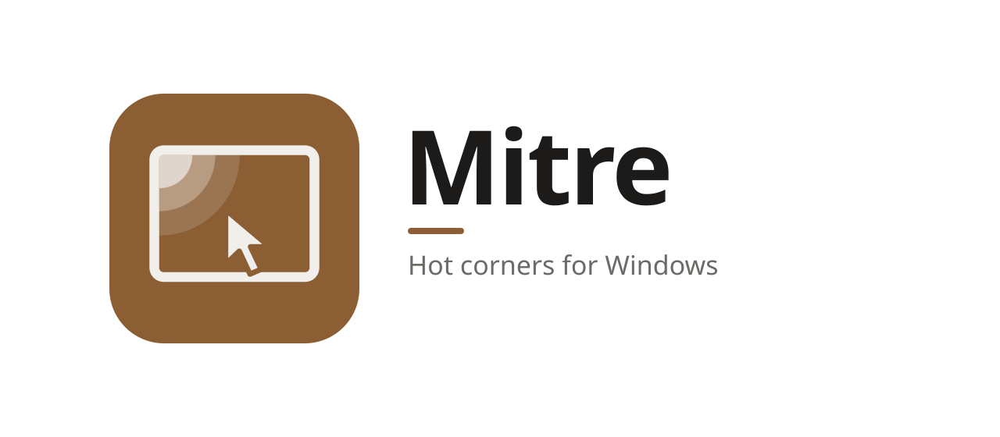
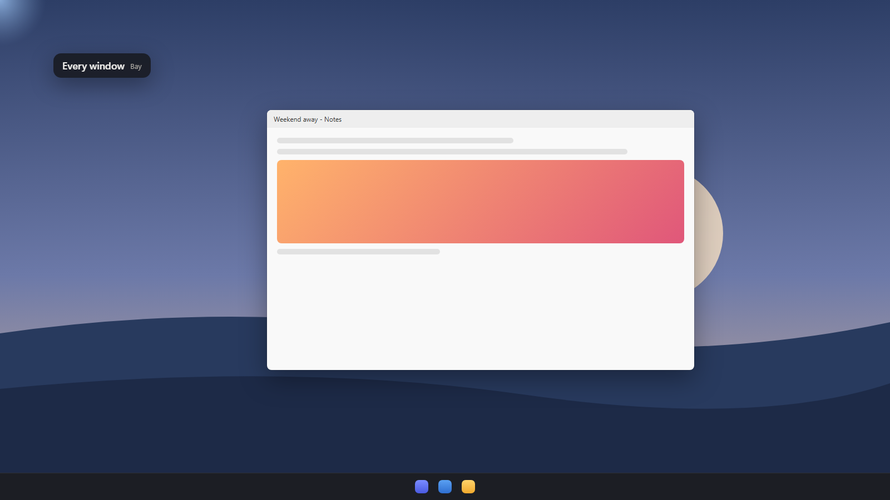
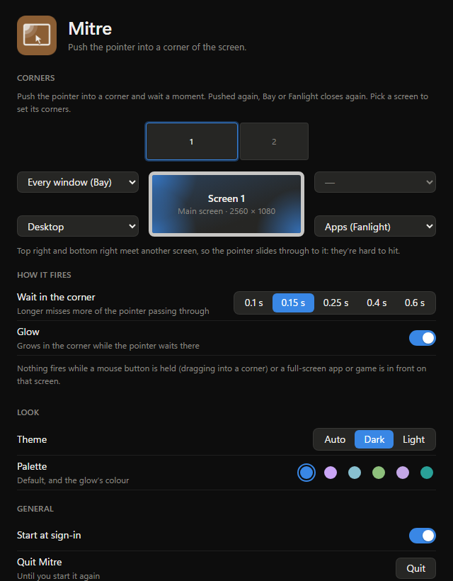
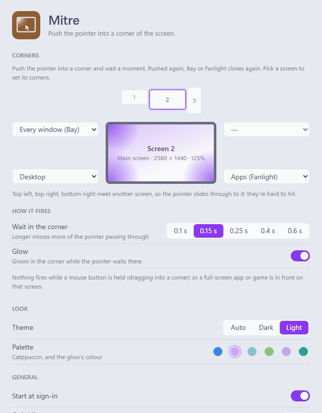

<picture>
  <source media="(prefers-color-scheme: dark)" srcset="assets/banner-dark.svg">
  
</picture>

**Hot corners for Windows.**

Push the pointer into a corner of the screen and wait a moment: every window at once, 
your apps, the desktop or Task View. Push again and it closes.

[Install](#install) · [Using it](#using-it) · [What a corner can do](#what-a-corner-can-do) · [FAQ](#faq) · [Contributing](CONTRIBUTING.md)

<picture>
  <source media="(prefers-color-scheme: light)" srcset="docs/images/corner-light.png">
  
</picture>

A Mac has hot corners: push the pointer into a corner of the screen and it shows every window, or
the desktop, or locks the screen. It's the quickest gesture there is, since a corner can't be
overshot. Windows has only one, the sliver at the end of the taskbar that shows the desktop.
Mitre gives you all four corners of every screen, each doing what you choose.

## Why Mitre

- **Every corner of every screen.** Each of them can open [Bay](../bay/README.md)'s overview,
  [Fanlight](../fanlight/README.md)'s search or its apps, or show the desktop, open Task View,
  lock the PC or turn the screens off. Or nothing.
- **Push again to close.** The same corner closes what it opened: Bay's overview, Fanlight's
  panel, Task View, the desktop.
- **Only when you mean it.** A short wait in the corner (0.15 s, or longer if you like), so
  passing through does nothing. Nothing fires while you drag (a mouse button held) or while a
  full-screen game, video or presentation is in front on that screen.
- **You see it coming.** A small glow grows in the corner while it waits, in your palette's
  colour, and flashes as the corner fires.
- **Light.** No mouse hook and no fast polling: Windows tells Mitre when the mouse moves (Raw
  Input), and all it does then is ask where the pointer is.
- **Private.** No account, no telemetry, and it never goes online. See [SECURITY.md](SECURITY.md).
- **Looks like it belongs.** Six palettes, each in dark and light, and Auto to follow Windows:
  the same ones as [Oriel](../oriel/README.md), [Lintel](../lintel/README.md),
  [Fanlight](../fanlight/README.md), [Bay](../bay/README.md) and [Sash](../sash/README.md).

## Using it

Open Mitre's settings (they open by themselves the first time) and pick what each corner does
from its menu. With more than one screen, pick a screen first: each has its own four corners.

Then push the pointer into that corner and leave it there a moment. A glow grows, the corner
fires, and the glow flashes and goes. Push into the same corner again to close what it opened.

Where two screens meet, the pointer slides through the corner to the next screen rather than
stopping there, so those corners are hard to hit. The settings say which ones they are.

## What a corner can do

| Action | What it does |
| --- | --- |
| Every window (Bay) | [Bay](../bay/README.md)'s overview of every open window; again to close it |
| Search (Fanlight) | [Fanlight](../fanlight/README.md)'s search panel; again to close it |
| Apps (Fanlight) | Fanlight on its Apps grid, every app at once, as Launchpad has them |
| Desktop | Every window out of the way, as <kbd>Win</kbd> + <kbd>D</kbd> does; again to put them back |
| Task View | Windows' Task View and desktops, as <kbd>Win</kbd> + <kbd>Tab</kbd> does |
| Lock | Locks the PC, as <kbd>Win</kbd> + <kbd>L</kbd> does |
| Screens off | Turns the screens off; moving the mouse or a key wakes them |
| — | Nothing |

Bay and Fanlight are Mullion's own apps. Their actions are greyed out until they're installed, and
the settings have a button to get them (it opens GitHub's release page in your browser, and says
so).

## Install

Mitre runs on Windows 10 and 11.

1. Download **Mitre-*version*-setup.exe** from the [latest release](https://github.com/Aduneer/Mullion/releases/latest), or
   **Mullion-*version*-setup.exe** there to pick from all of Mullion's apps at once (with Bay and
   Fanlight, for their corners).
2. Run it. It installs just for you, with no admin prompt, and adds Mitre to the Start menu.
3. Start Mitre. Its settings open the first time; give a corner something to do, and push the
   pointer into it. After that it waits in the notification area.

Prefer not to install anything? Download **Mitre-*version*-portable.zip** instead, unzip it into a
folder of its own (not straight into Downloads) and run `mitre.exe`.

> [!IMPORTANT]
> Mitre isn't code-signed yet, so Windows doesn't know who made it:
> - **SmartScreen** may say *Windows protected your PC*. Click **More info**, then **Run anyway**.
> - **Smart App Control**, if it's on, may block Mitre: it only lets unsigned apps run when
>   Microsoft's cloud service judges them safe, and it has no "run anyway". It judges each file
>   on its own, so if it blocks the portable zip, try the installer. If it blocks that too, you
>   can [build Mitre yourself](CONTRIBUTING.md#building-from-source) until it's signed.
>   Please don't turn Smart App Control off for Mitre: on most versions of Windows it can only
>   be turned back on by reinstalling Windows.
>
> Each release lists the SHA-256 of its files in `SHA256SUMS.txt`, so you can check a download
> with `Get-FileHash`.

To uninstall, go to **Settings → Apps → Installed apps → Mitre**. Tick
**Delete the application data** to also remove your settings and the sign-in entry.

## Settings

**Settings…** in the notification-area menu, or a click on Mitre's icon. Changes apply and save as
you make them, to `%APPDATA%\Mitre\settings.json`:

- **Corners**: a picture of each screen with a menu at each corner
- **Wait in the corner**: 0.1 s to 0.6 s
- **Glow**: on or off
- **Theme**: Auto, dark or light, and a **palette**, which is the glow's colour too
- **Start at sign-in**

  
  

## Part of Mullion

Mitre is one of [Mullion](https://github.com/Aduneer/Mullion)'s apps, which rework the Windows desktop, with
[Oriel](../oriel/README.md), the dashboard for your second screen,
[Lintel](../lintel/README.md), the menu bar, [Fanlight](../fanlight/README.md), search and launch,
[Bay](../bay/README.md), every window at once, and [Sash](../sash/README.md), windows snapped from
the keyboard. They share their themes, and Mullion's installer installs any of them in one go.
Each is still its own program, which works alone.

## FAQ

**Why is it called Mitre?**
A mitre is the joint at the corner of a window's frame, where two pieces meet at an angle.

**It fired when I didn't want it to.**
Make the wait longer in Settings. A corner you hit by accident (a menu in the top left, say) is
better left as nothing.

**It doesn't fire in a game.**
On purpose: nothing fires while a full-screen app or game is in front on that screen, so you can't
open Bay in the middle of a match. A game in a window, or in borderless windowed mode, may look
full screen to Windows too.

**It doesn't fire over an app running as administrator.**
Windows doesn't let a normal program act over one running as administrator (Task Manager, for
one), and while one is in front, Windows may not tell Mitre the mouse moved. It works again as soon
as another window is in front.

**Does it slow my PC down?**
No. Windows wakes it when the mouse moves, and all it does then is ask where the pointer is: well
under half a percent of one core while you move the mouse, and one look a second while you don't.
No admin rights, drivers or services.

**Does it go online?**
No. The one button that opens GitHub in your browser says so.

**Why isn't it signed?**
Code signing needs a paid certificate and an identity check. It's planned.

## Roadmap

- Actions of your own: open a program, a file or a folder
- Signed releases, then winget

Something you'd like to see? Say so in [Discussions](https://github.com/Aduneer/Mullion/discussions).

## Contributing

Bug reports, ideas and pull requests are welcome: [open an issue](https://github.com/Aduneer/Mullion/issues/new/choose) for a
bug, or start a [discussion](https://github.com/Aduneer/Mullion/discussions) for an idea or a question.
[CONTRIBUTING.md](CONTRIBUTING.md) covers building from source, how Mitre works and working on its
pages in a browser without building the Rust side.

## License

[MIT](LICENSE)

The palettes other than the Default one (Oriel's own) are adapted from [Catppuccin](https://catppuccin.com),
[Nord](https://www.nordtheme.com), [Gruvbox](https://github.com/morhetz/gruvbox),
[Rosé Pine](https://rosepinetheme.com) and [Solarized](https://ethanschoonover.com/solarized/),
all MIT licensed.
