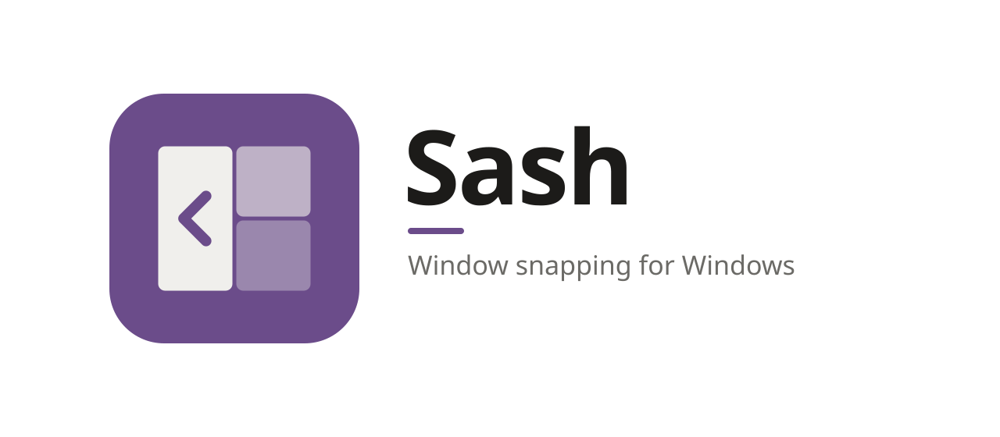
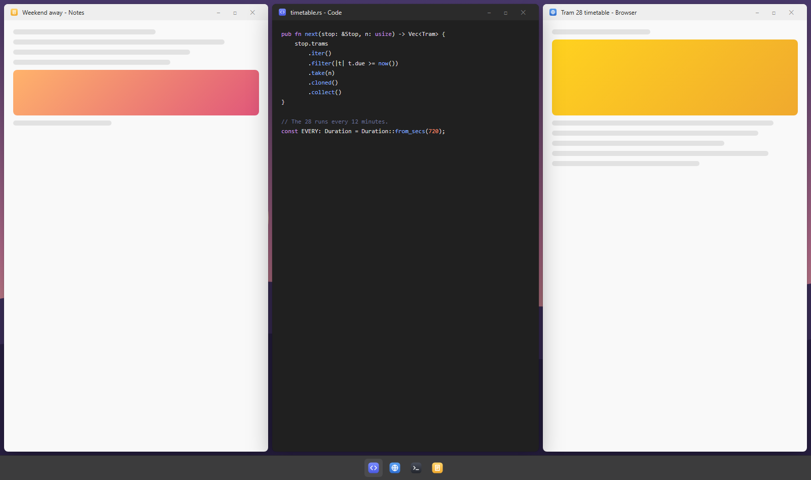
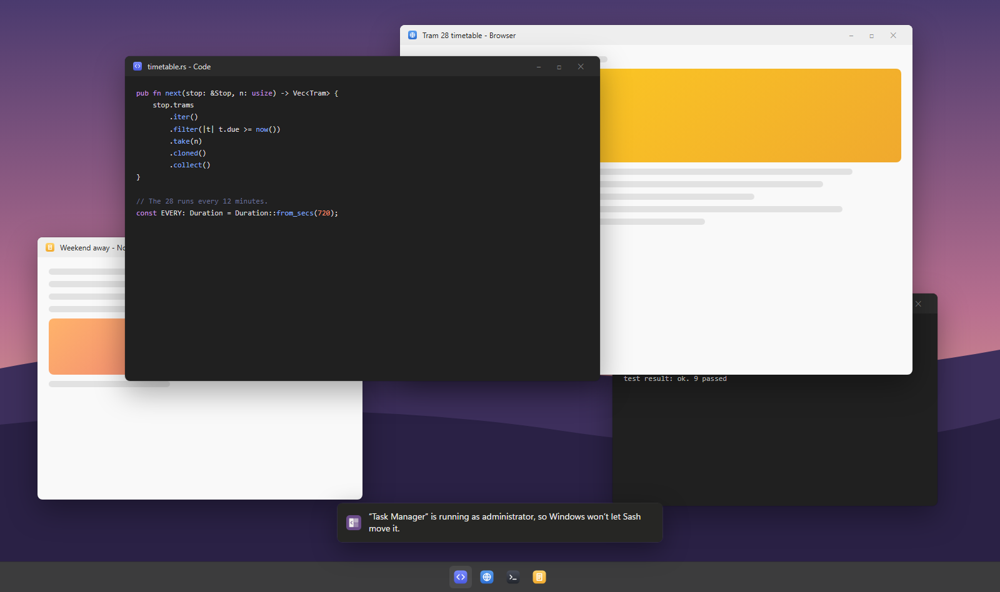
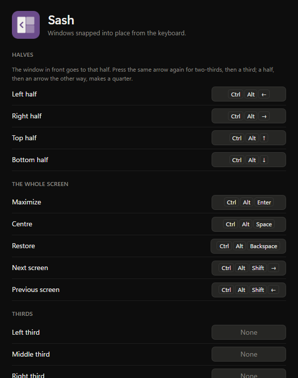
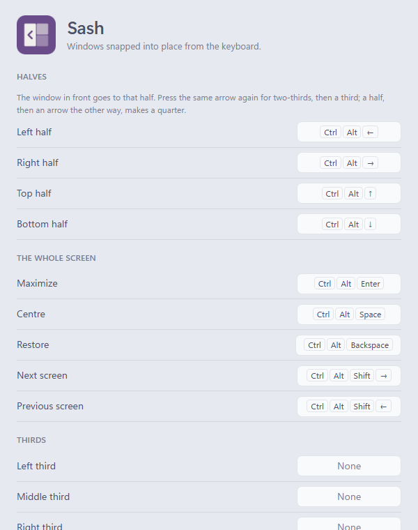

<picture>
  <source media="(prefers-color-scheme: dark)" srcset="assets/banner-dark.svg">
  
</picture>

**Window snapping for Windows.**

Press <kbd>Ctrl</kbd> + <kbd>Alt</kbd> + <kbd>←</kbd> and the window in front takes the left half 
of the screen. Press it again for two-thirds, then a third. Quarters, centre, the next screen: all from the keyboard.

[Install](#install) · [Using it](#using-it) · [Keys](#keys) · [Windows' own Snap](#windows-own-snap) · [FAQ](#faq) · [Contributing](CONTRIBUTING.md)

<picture>
  <source media="(prefers-color-scheme: light)" srcset="docs/images/snapped-light.png">
  
</picture>

On a Mac, apps like Rectangle and Magnet put a window on half the screen, or a third, or a
quarter, with a key. Windows has Snap on <kbd>Win</kbd> + arrows, but it stops at halves and
quarters, opens a picker for the other side when you didn't ask for one, and leaves a sliver of
gap where each window's invisible border is. Sash is the other kind: one key, the window goes
there, and it meets the window beside it exactly.

## Why Sash

- **Halves, thirds and quarters.** An arrow sends the window to that half. Press it again for
  two-thirds, then a third. A half, then an arrow the other way, makes a quarter.
- **Windows meet exactly.** Sash places what you see of a window, not its invisible resize
  borders, so two windows side by side share an edge with nothing between them. Or pick a gap.
- **Every screen.** Each screen's own work area, at its own scaling, with the taskbar and
  [Lintel](../lintel/README.md)'s bar left alone. Send a window to the next screen and it keeps its
  place there.
- **Beside Windows' own Snap**, not instead of it. <kbd>Win</kbd> + arrows and dragging to an edge
  still work as they always have.
- **Light.** It waits for its shortcuts and does nothing else: no keyboard or mouse hook, no
  polling, and no window at all until you open its settings.
- **Private.** No account, no telemetry, and it never goes online. See [SECURITY.md](SECURITY.md).
- **Looks like it belongs.** Six palettes, each in dark and light, and Auto to follow Windows:
  the same ones as [Oriel](../oriel/README.md), [Lintel](../lintel/README.md),
  [Fanlight](../fanlight/README.md) and [Bay](../bay/README.md).

## Using it

Click into a window and press <kbd>Ctrl</kbd> + <kbd>Alt</kbd> and an arrow. That's it: Sash moves
the window that's in front, on the screen it's on.

- **An arrow** sends it to that half: <kbd>←</kbd> the left, <kbd>↑</kbd> the top.
- **The same arrow again** makes it two-thirds of the screen, then a third, then a half again.
  Turn off **Pressing again** in Settings to keep halves.
- **A half and the other arrow** makes a quarter: the left half, then <kbd>↑</kbd>, is the top-left
  quarter, as Windows' own <kbd>Win</kbd> + arrows do. From a quarter, an arrow moves it to the
  quarter beside it, or, toward its own side, fills that side.
- <kbd>Enter</kbd> maximizes it, and again puts it back. <kbd>Space</kbd> centres it at its own
  size. <kbd>Backspace</kbd> puts it back where it was before Sash first moved it.
- <kbd>Shift</kbd> with <kbd>←</kbd> or <kbd>→</kbd> sends it to the screen before or after, in
  the same place there, scaled for that screen.

Thirds, two-thirds and the four quarters have their own actions too, without a shortcut to start
with; give them one in Settings. With **Space between windows** on, they keep the same gap between
them as around the screen's edges:

**Windows Sash can't move.** Windows doesn't let a program move the windows of a program that's
running as administrator (Task Manager, for one), and Sash leaves alone a window that isn't
responding rather than wait on it. Either way it says so in a small note at the bottom of the
screen, which goes by itself:

A window with a smallest size (some settings windows) stays that size and keeps to its side of the
screen.

## Keys

| Key | What it does |
| --- | --- |
| <kbd>Ctrl</kbd> + <kbd>Alt</kbd> + <kbd>←</kbd> <kbd>→</kbd> <kbd>↑</kbd> <kbd>↓</kbd> | That half; again for two-thirds, then a third; the other way for a quarter |
| <kbd>Ctrl</kbd> + <kbd>Alt</kbd> + <kbd>Enter</kbd> | Maximize, or put it back |
| <kbd>Ctrl</kbd> + <kbd>Alt</kbd> + <kbd>Space</kbd> | Centre, at its own size |
| <kbd>Ctrl</kbd> + <kbd>Alt</kbd> + <kbd>Backspace</kbd> | Back to where it was before Sash moved it |
| <kbd>Ctrl</kbd> + <kbd>Alt</kbd> + <kbd>Shift</kbd> + <kbd>→</kbd> <kbd>←</kbd> | The next screen, or the one before |
| None to start with | Left, middle and right thirds, left and right two-thirds, each quarter |

Every one can be changed in Settings: click it and press the keys you want.

## Windows' own Snap

Sash sits beside Windows' Snap and doesn't change it. <kbd>Win</kbd> + arrows, dragging a window
to an edge of the screen, and the layouts over the maximize button all work as they did. If you'd
rather have only Sash, **Open its settings** in Sash's settings takes you to Windows' Settings →
System → Multitasking, where Snap can be turned off. Sash never changes it for you, and can't take
over <kbd>Win</kbd> + arrows: Windows keeps those for itself.

## Install

Sash runs on Windows 10 and 11.

1. Download **Sash-*version*-setup.exe** from the [latest release](https://github.com/Aduneer/Mullion/releases/latest), or
   **Mullion-*version*-setup.exe** there to pick from all of Mullion's apps at once.
2. Run it. It installs just for you, with no admin prompt, and adds Sash to the Start menu.
3. Start Sash. Its settings open the first time; after that it waits in the notification area.
   Press <kbd>Ctrl</kbd> + <kbd>Alt</kbd> + <kbd>←</kbd>.

Prefer not to install anything? Download **Sash-*version*-portable.zip** instead, unzip it into a
folder of its own (not straight into Downloads) and run `sash.exe`.

> [!IMPORTANT]
> Sash isn't code-signed yet, so Windows doesn't know who made it:
> - **SmartScreen** may say *Windows protected your PC*. Click **More info**, then **Run anyway**.
> - **Smart App Control**, if it's on, may block Sash: it only lets unsigned apps run when
>   Microsoft's cloud service judges them safe, and it has no "run anyway". It judges each file
>   on its own, so if it blocks the portable zip, try the installer. If it blocks that too, you
>   can [build Sash yourself](CONTRIBUTING.md#building-from-source) until it's signed.
>   Please don't turn Smart App Control off for Sash: on most versions of Windows it can only
>   be turned back on by reinstalling Windows.
>
> Each release lists the SHA-256 of its files in `SHA256SUMS.txt`, so you can check a download
> with `Get-FileHash`.

To uninstall, go to **Settings → Apps → Installed apps → Sash**. Tick
**Delete the application data** to also remove your settings and the sign-in entry.

## Settings

**Settings…** in the notification-area menu, or a click on Sash's icon. Changes apply and save as
you make them, to `%APPDATA%\Sash\settings.json`:

- **A shortcut for each action**: click one and press the keys, <kbd>Delete</kbd> for none
- **Pressing again**: two-thirds, then a third, or always a half
- **Space between windows**: none, small, medium or large, between them and around the screen's
  edges
- **Theme**: Auto, dark or light, and a **palette**
- **Start at sign-in**

  
  

## Part of Mullion

Sash is one of [Mullion](https://github.com/Aduneer/Mullion)'s apps, which rework the Windows desktop, with
[Oriel](../oriel/README.md), the dashboard for your second screen,
[Lintel](../lintel/README.md), the menu bar, [Fanlight](../fanlight/README.md), search and launch,
and [Bay](../bay/README.md), every window at once. They share their themes, and Mullion's
installer installs any of them in one go. Each is still its own program, which works alone.

## FAQ

**Why Ctrl + Alt, and not Win?**
Windows keeps <kbd>Win</kbd> + arrows for its own Snap, and won't let another program have them.
<kbd>Ctrl</kbd> + <kbd>Alt</kbd> + arrows is what Rectangle uses on a Mac, and types nothing.

**Why no letters, like Rectangle's?**
On many keyboards (German, Polish, Romanian and others) <kbd>Ctrl</kbd> + <kbd>Alt</kbd> is
<kbd>AltGr</kbd>, which types € or @ or ă with a letter. A shortcut on <kbd>Ctrl</kbd> +
<kbd>Alt</kbd> + <kbd>E</kbd> would swallow €. So Sash takes only keys that type nothing; you can
still give an action a letter in Settings, and it tells you when that's also an <kbd>AltGr</kbd> key.

**It says a shortcut is taken.**
Another app has it. Some graphics drivers turn the screen with <kbd>Ctrl</kbd> + <kbd>Alt</kbd> +
arrows; turn that off in the driver's settings, or give Sash other keys.

**Ctrl + Alt + ↑ used to do something in my editor.**
A shortcut Sash has works everywhere, so it wins over the same keys inside an app: Visual Studio
Code's *Add cursor above* is <kbd>Ctrl</kbd> + <kbd>Alt</kbd> + <kbd>↑</kbd>, and JetBrains IDEs
go back and forward with <kbd>Ctrl</kbd> + <kbd>Alt</kbd> + <kbd>←</kbd> <kbd>→</kbd>. Change
Sash's, or the app's, in Settings. While you choose a new shortcut in Sash's settings, Sash lets
go of all of its own.

**Can I drag a window to an edge to snap it?**
Windows' own Snap does that, beside Sash. Sash's own drag zones may come later.

**Does it slow my PC down?**
No. It registers its shortcuts with Windows and waits; it doesn't watch the keyboard, the mouse
or your windows. No admin rights, drivers or services.

**Does it go online?**
No.

**Why isn't it signed?**
Code signing needs a paid certificate and an identity check. It's planned.

## Roadmap

- Drag zones with Sash's own places (thirds too), and layouts of your own
- Dropping a window on half of a screen in [Bay](../bay/README.md)'s overview
- Signed releases, then winget

Something you'd like to see? Say so in [Discussions](https://github.com/Aduneer/Mullion/discussions).

## Contributing

Bug reports, ideas and pull requests are welcome: [open an issue](https://github.com/Aduneer/Mullion/issues/new/choose) for a
bug, or start a [discussion](https://github.com/Aduneer/Mullion/discussions) for an idea or a question.
[CONTRIBUTING.md](CONTRIBUTING.md) covers building from source, how Sash works and working on its
pages in a browser without building the Rust side.

## License

[MIT](LICENSE)

The palettes other than the Default one (Oriel's own) are adapted from [Catppuccin](https://catppuccin.com),
[Nord](https://www.nordtheme.com), [Gruvbox](https://github.com/morhetz/gruvbox),
[Rosé Pine](https://rosepinetheme.com) and [Solarized](https://ethanschoonover.com/solarized/),
all MIT licensed.
